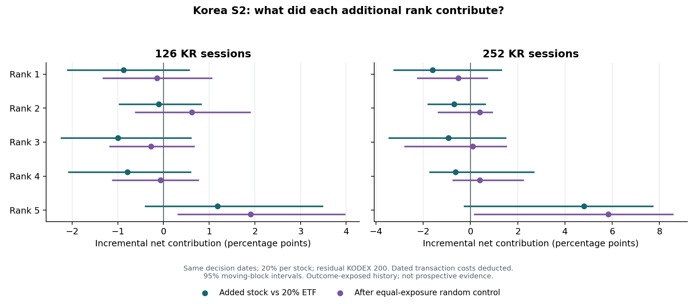

# 한국 S2: 종목을 하나씩 추가했을 때 무엇이 기여했나

기준: PR #348 `3a3e9d8e60c90bf6707072efca9d1dabf3cb79ac` · 작성 2026-11-17 · 계산 전 설계: `7a6ec28`의 [PREREGISTRATION.md](PREREGISTRATION.md).

상태: **이미 결과를 연구한 과거 표본의 후속 검산**(`FOLLOW_UP_ON_OUTCOME_EXPOSED_HISTORY_NOT_PROSPECTIVE`). 운영 승격·전향 성과가 아니다.

## 핵심 결과

**“상위 몇 번째까지 기여가 있다”는 연속적인 경계는 관찰되지 않았다.** 1~4번째 종목의 ETF 대체 대비 추가 기여는 6·12개월 모두 평균이 음수다. **5번째만 +1.18%p/6개월, +4.80%p/12개월**이지만 두 구간 모두 0을 포함한다. 5번째를 빼고 상위 1~4개에 집중하면 이 표본에서는 오히려 결과가 나빠졌다. 이것은 5번째가 언제나 유효하다는 뜻도 아니다.[1]

5번째의 개선은 2022년 이후와 소수 반도체 종목에 집중됐다. 추가 기여의 약 79%가 삼성전자·SK하이닉스에서 나온다. 동일 종목 수·ETF 비중의 무작위 대조군 대비 5번째 기여는 양수지만, **업종·시총을 맞춘 추가분 대비로는 6개월 +0.42 [−1.97, +2.82]%p**여서 구분되지 않는다. 원 순위가 산업·시총 노출을 넘어 안정적으로 종목 수 경계를 알려준다고 볼 수 없다.[1, 2]

**과거 성적만으로 판단일에 종목 수를 정할 근거도 나오지 않았다.** 그날 이전에 만기 된 기록만 사용해 평균 순초과가 가장 높은 종목 수를 고르는 한 가지 규칙은 ETF 대비 −3.70%p/6개월, −2.28%p/12개월이었다. 이번에 시험한 규칙은 실패했고, 모든 가능한 과거 기반 규칙이 불가능하다는 증명은 아니다. 같은 과거에서 창·문턱·개수를 다시 골라 채택하지 않는다.[3]

## 1. 각 순위의 비용 차감 추가 기여

같은 판단일에 같은 진입·청산일을 가진 장부를 비교한다. N0는 KODEX 200 100%, Nk는 기존 S2 순위 앞 k개를 각각 20%, 나머지는 ETF다. 종목이 부족하면 그 슬롯은 ETF로 남긴다. 아래는 `Nk 순수익 − N(k−1) 순수익`의 평균이다. 순위가 없는 날은 추가 기여 0이다.[1]

|추가 순위|6개월 추가 기여 [95%], %p|12개월 추가 기여 [95%], %p|
|---|---:|---:|
|1|−0.87 [−2.11, +0.57]|−1.61 [−3.27, +1.33]|
|2|−0.10 [−0.98, +0.84]|−0.69 [−1.82, +0.65]|
|3|−0.99 [−2.26, +0.61]|−0.93 [−3.47, +1.51]|
|4|−0.79 [−2.09, +0.60]|−0.63 [−1.74, +2.71]|
|5|+1.18 [−0.41, +3.50]|+4.80 [−0.29, +7.73]|

- 판단일 454개: 2018-01-05 ~ 2026-09-11. 6개월 만기 코호트 427개(~2026-03-06), 12개월 400개(~2025-08-29). 가격 종료일은 2026-09-14다. #348의 K2 **게이트 계산 가능 표본**으로 줄이지 않고 원 S2의 판단일 전체를 쓴다.
- 25/50주 블록의 근사 독립 정보량은 17.08/8.00블록이다. 코호트 427/400개가 독립 관측 427/400개라는 뜻이 아니다.
- 6개월 5개 순위 Holm 보정의 근사 p는 1~4위 1.000, 5위 0.300이다. 어느 순위도 양의 기여가 분리되지 않는다. 공개된 과거·여러 선행 연구에 조건부인 서술용 통계다.
- 원 S2 실제 종목 수는 **5개 441일, 3개 1일, 2개 12일**이다. 부족한 13일은 모두 2018-01-05 ~ 2018-03-30이다. 요청 수·실제 수·ETF 비중·순서가 [decisions.csv](results/decisions.csv)에 있다. 5위가 실제 존재하는 날만의 추가 기여는 +1.22%p/6개월, +4.96%p/12개월로, 결론은 같다.
- 여섯 장부의 공통 가격 미해결 코호트는 **0개**다. 미만기 27/54개는 수익을 채우지 않고 [excluded-cohorts.csv](results/excluded-cohorts.csv)에 분리했다.



청록은 ETF 20%를 해당 순위 종목으로 바꾼 순기여, 보라는 같은 적격군에서 균등 추출한 종목의 추가분까지 차감한 값이다. 선은 95% 이동 블록 구간이다. 두 패널의 가로축 범위가 다르다. 전체 숫자는 [TABLES-ko.md](TABLES-ko.md)에 있다.

## 2. 선택 효과와 ETF를 줄인 효과

**대조군을 붙여야 “ETF보다 못했다”와 “선택이 무작위보다 못했다”를 구분할 수 있다.** 무작위 대조군은 같은 날짜·같은 적격군에서 같은 실제 종목 수를 무복원 균등 추출하고, 각각 20%와 동일 ETF 잔여비중을 둔다. 고정보유 수익은 비중에 선형이므로 그 기대값을 정확히 계산했다. 특정 난수 경로에 의존한 고정보유 결론이 아니다.[1]

`Nk−ETF = (Nk−동일노출 무작위) + (동일노출 무작위−ETF)`

|종목 수|6개월 ETF 대비 순초과|무작위 대비 선택 부분|적격군 주식 노출 부분|12개월 ETF 대비 순초과|
|---|---:|---:|---:|---:|
|0|0.00|0.00|0.00|0.00|
|1|−0.87|−0.14|−0.73|−1.61|
|2|−0.98|+0.48|−1.46|−2.30|
|3|−1.97|+0.21|−2.18|−3.23|
|4|−2.76|+0.14|−2.90|−3.87|
|5|−1.58|+2.05|−3.63|+0.93|

단위 %p/해당 보유기간. 노출 부분에는 이 **적격군의 업종·스타일·종목 구성**도 들어간다. 순수 시장 베타의 인과 추정이 아니다. 목표 ETF 비중은 같고, 보유 중 수익 차이로 생기는 비중 드리프트까지 같도록 강제한 것은 아니다.

따라서 원 S2 전체는 6개월에 ETF보다 −1.58%p였지만, 같은 적격군을 임의로 다섯 개 고르는 것보다는 +2.05%p 좋았다. “주식을 고른 정보가 전혀 없다”와 “비용 후 ETF를 이기는 구성이다”는 다른 주장이다. 무작위 대비 전체 선택 부분의 구간도 [−1.63, +5.55]로 넓다.

추가로 원 S2 다섯 이름 전부를 제외한 품질 적격 종목 중 같은 업종·가장 가까운 시총 백분위 종목을 순위 순서로 중복 없이 매칭했다. **6개월 427/427, 12개월 400/400 코호트에서 완전 매칭**됐다. ETF 대체로 실패를 숨긴 날짜는 없다.

|5번째 추가분을 무엇과 비교하나|6개월 [95%], %p|12개월 [95%], %p|
|---|---:|---:|
|ETF 추가분 대비|+1.18 [−0.41, +3.50]|+4.80 [−0.29, +7.73]|
|동일노출 무작위 추가분 대비|+1.91 [+0.30, +3.98]|+5.83 [+0.14, +8.58]|
|업종·시총 매칭 추가분 대비|+0.42 [−1.97, +2.82]|+2.17 [−4.18, +7.53]|

무작위 대비 양의 구간은 보조 비교의 명목 95% 구간이며 별도의 다중비교 통과 주장으로 쓰지 않는다. 매칭 결과까지 보면 5번째 효과를 일반적인 순위 예측력으로 읽기 어렵다.

## 3. 운용 장부: 5번째가 회복시켰지만 낙폭도 깊었다

동일 초기 자본의 26/52개 계정을 매주 분산 진입시키고 각 계정은 26/52주마다 자기 날짜에만 거래한다. 2018-01-08 ~ 2026-09-14, 원래 `analyze.multi_account`를 그대로 호출했다. 최초에는 ETF로 대기하며 계정 간 자본 재배분은 없다.[4]

|종목 수|L26 ETF 대비 CAGR 차이, %p/년|L26 MDD, %|L26 편도 회전율/년|L26 연 비용, %|L52 ETF 대비 CAGR 차이, %p/년|L52 MDD, %|L52 편도 회전율/년|
|---|---:|---:|---:|---:|---:|---:|---:|
|0|0.00|−40.81|0.00|0.00|0.00|−40.81|0.00|
|1|−0.96|−44.27|0.38|0.11|−0.78|−43.27|0.22|
|2|−0.55|−43.37|0.71|0.21|−0.74|−44.14|0.41|
|3|−1.52|−45.95|1.01|0.30|−1.19|−46.06|0.59|
|4|−2.51|−47.55|1.26|0.39|−1.26|−46.90|0.76|
|5|−0.39|−48.50|1.49|0.46|+0.91|−48.19|0.91|

ETF CAGR은 16.96%다. N5의 CAGR은 L26 16.56%, L52 17.87%다. L52 연 비용은 N1~N5 각각 0.06/0.12/0.17/0.22/0.27%다.

- **4→5개의 장부 차이:** L26 CAGR 차이는 +2.12%p/년이며 일수익 차이 연율은 약 +1.86, 복리 잔여는 약 +0.27이다. L52는 CAGR 차이 +2.17, 일수익 차이 약 +1.91, 복리 잔여 약 +0.27이다(각 표시값 반올림). CAGR 차이 전체를 종목 선택 알파라고 부르지 않는다.
- L26에서 2번째 추가의 CAGR 차이는 +0.42%p지만, 고정보유 6개월 추가 기여는 −0.10%p다. 계정별 자본 경로·드리프트·재거래를 가진 운용 장부와 같은 초기 비중의 고정보유 평균은 다른 측정이다. 두 값을 서로 대체하지 않는다.
- 5번째를 넣으면 4개 대비 수익은 회복되지만 MDD는 L26 −47.55→−48.50%, L52 −46.90→−48.19%로 더 깊어진다. 좋은 추가 수익 점추정이 곧 낙폭 개선을 뜻하지 않는다.
- 무작위 운용 5경로의 N5 평균 ETF 대비 차이는 L26 −5.17, L52 −4.63%p/년이다. S2 N5가 그보다 각각 +4.78/+5.54 높다. **5경로 범위는 신뢰구간이 아니다.** 고정보유의 정확 기대값과도 구분한다.
- 이름 교체 비율과 유지 자산의 비중 재설정은 [전체 결과표](TABLES-ko.md)에 별도 병기했다. 엔진의 실제 편도 회전율과 근사 L1 진단을 합산하지 않는다.

같은 날짜의 일별 NAV는 `daily-nav-L{26,52}.csv`, 인접 일수익 차이는 `daily-adjacent-L{26,52}.csv`에 남겼다. 최대낙폭은 각 전체 장부의 위험이지 한 순위에 가산 배분할 수 있는 수익 기여가 아니다.

## 4. 반도체 주도기와 시기에 민감하다

기존 월 라벨을 그대로 썼다. 126세션 전의 PIT Top120 시총 비중으로 계산한 시장 proxy가 양수이고 삼성전자·SK하이닉스가 그 수익의 절반 이상이면 `SEMI_LED`다. 해당 월에 **보유 창이 닿는지**는 미래 경로를 이용한 사후 분할이다. 판단일의 개수 신호로 쓰지 않았다.[1, 2]

|5번째 추가 기여|6개월, %p|12개월, %p|
|---|---:|---:|
|신호 2022 이전|−0.23|−0.24|
|신호 2022 이후|+2.54|+10.32|
|반도체 주도 월에 닿음|+0.82|+7.43|
|반도체 주도 월 제외(라벨 측정 가능)|+1.52|+0.33|

- 12개월의 큰 개선은 반도체 주도 구간 밖에서 거의 사라진다. 6개월은 제외 표본에서도 양수지만 구간은 [−1.08, +4.67]로 넓다. 다른 순위·모든 분할 구간은 [전체 표](TABLES-ko.md)에 있다.
- 원 판단일 이전의 시장 proxy 구성이 없어 라벨을 완전히 측정할 수 없는 초기 25코호트는 ‘반도체 주도 아님’으로 단정하지 않았다. 6개월 포함 199개·제외 203개, 12개월 포함 252개·제외 129개다. 12개월의 25개 미정 중 일부는 뒤쪽의 주도 월에 닿으므로 포함 여부와 미정 수가 단순 합산되지 않는다.
- **결과를 본 뒤 추가한 읽기 전용 기여 진단:** 5번째의 삼성전자·SK하이닉스 직접 순기여는 전체 코호트 평균으로 6개월 +0.94%p(총 +1.18의 79.3%), 12개월 +3.78%p(총 +4.80의 78.7%)다. 5번째로 두 종목을 가진 코호트는 62/427, 61/400개다. 이 진단은 규칙·표본·수익·가격을 바꾸지 않았고, 코호트 파일의 바이트 동일성을 확인했다. 종목을 사후 제거한 새 전략 성과가 아니다.
- 5번째 추가 기여의 중앙값은 6개월 +0.15%p, 12개월 +0.03%p이며 양수 비율은 51.3%, 50.0%다. 평균의 개선이 폭넓은 날짜의 확실한 우위를 뜻하지 않는다.

## 5. 판단일 이전 과거만으로 종목 수를 골라 보니

현재 판단일보다 **청산일이 엄격히 앞선** 6개월 코호트만 사용했다. 만기 52개 이상이면 N0~N5 중 확장 평균 순초과가 최대인 수를 선택하고, 동점은 작은 수, 그 전에는 N0다. 12개월 보유의 평가에도 같은 판단일 선택을 쓴다. 창·문턱·선택 규칙을 결과에 맞춰 다시 바꾸지 않았다.[3]

|보유기간|선택 규칙−ETF [95%], %p|같은 날짜 N5 대비 [95%], %p|평가 코호트|
|---|---:|---:|---:|
|6개월|−3.70 [−6.68, −0.18]|−1.37 [−5.01, +2.63]|348|
|12개월|−2.28 [−7.99, +0.01]|−4.41 [−11.52, +1.81]|321|

454개 판단일의 선택은 N0 373일, N5 81일이었다. N1~N4를 고른 날은 없었다. 실제 전환은 2019-07-12 N5, 2020-03-20 N0, 2025-07-25 N5, 2026-06-05 N0다. 각 판단일의 학습 만기 수·최후 청산일·여섯 과거평균은 [past-only-decisions.csv](results/past-only-decisions.csv)에 있다. 모든 행에서 `lastTrainExit < 판단일`을 검사했다.

운용 장부도 ETF 대비 L26 −4.56%p/년(MDD −50.94%), L52 −2.30%p/년(MDD −44.55%)였다. **이 한 규칙으로는 개수를 정하지 않는 쪽이 낫다는 역사적 결과**다. 현재 표본에서 사후 최고인 개수를 찾아 미래에도 쓰자는 결론은 내리지 않는다. 다음 증거는 기존 전향 경로에서 별도로 쌓아야 한다.

## 6. 입력·전향 기록·재실행

### 입력은 복구했고 추가로 받아야 할 파일은 없다

`#348 REPORT → kr_switch → round6.kr → s2_decomposition → sg1_random_control.setup → analyze.load`를 확인했다. 최초 작업 공간에는 저장소·기존 캐시가 없었다. 저장소 밖 파일을 요청하기 전에 원 산출물과 고정 Git 원천을 확인하고 **모든 필요 입력을 재생성했다.** 상세 파일명·원천 커밋·복구 명령은 [SOURCES-ko.md](SOURCES-ko.md)에 있다.[5]

- 순위: 원 `C.sleeve_book`의 점수 내림차순·티커 오름차순 순서다. 티커 정렬된 `sg1_random_control.stocks()`를 순위로 오인하지 않았다. 매일 기존 S2 보유·적격군 캐시와 일치를 확인했다.
- 특성 원천: signal-history `4ea107ed`, 회계 `fb6e8374`, #329 생성기 `0a1f4941`. **행렬 85,680행·76열 digest `32e49b57…`, 입력 identity `3e4d7aa3…`가 기존과 정확히 일치했다.**
- 주식 가격: replay-v16 조건부 조정 가격 + 최종 세션 정정 + OCI 정정. 새 OCI를 구 OCI에 무비용 재투자한 근사는 원 연구와 같다. 모든 주식의 기업행위 경제수익을 새로 독립 인증한 연구는 아니다. 후일 확인된 조정 가격의 vintage 한계도 이어받는다.
- ETF: 삼성자산운용 공식 시장가격·분배금으로 배당락일 종가 재투자한 **투자자 분배금 세전** 총수익. Naver 가격 재구성과 기존 연간 대조는 PASS이며 현금 분배 원천은 공유한다. 원 replay ETF 가격을 그대로 쓴 것이 아니다. 거래비용 차감 순수익과 투자자 세후 수익을 혼동하지 않는다.
- 필요 캐시는 `/workspace/s2-inputs/{matrix.pkl,dataset.pkl,macro_panel.pkl,vix_fx.pkl,sg1-random-setup.pkl}`, 시총 shard는 `/workspace/s2-inputs/raw/ledger/universe/kr/`에 복구됐다. 구매한 데이터는 없다. 미국 공시 추가 구매·미국 연구는 이번 범위에서 제외했다.

### 기존 전향 경로는 보존하고 별도 상태로 관리한다

기준 커밋의 네 장부 기록기는 `PREPARED_NOT_AUTHORIZED`, `REGISTERED_AUTHORIZATION=None`이다. 기존 preview 영수증 7개(2026-09-11 ~ 2026-10-23)는 **전향 관측이 아니다.** 기존 기록·규칙은 기준 커밋과 바이트 동일하게 보존했고, 새 연구의 과거 성과와 합치지 않았다.[6]

이번 세션에 실제 전향 영수증을 새로 추가하지 못했다. 기록기 자체의 등록된 실행 승인 부재와 현재 시점 입력의 검증 미완료가 남아 있고, 이미 지난 판단일의 작성 창을 소급해서 채울 수 없다. 이 제약은 새 연구 결과와 별개다. 기존 `latest_inputs.py → weekly_records.py → prospective/recorder.py` 경로를 병행 경로로 유지한다. 이 연구에서 별도 승인 값을 꾸미거나 운영·봉인 파일을 수정하지 않았다.

### 재실행 명령

이 저장소의 연구 브랜치에서 실행한다. 깨끗한 환경은 `constraints/ci-registered-numerics-v1.txt` 제약으로 저장소 `requirements.txt`, `requirements-dev.txt`를 설치한다. 원천 복구는 첫 실행에 약 17분(이번 측정 1,011.5초), 뒤 장부 계산은 수분이 걸렸다.

```bash
# 기존 복구 입력으로 전체 계산
OMP_NUM_THREADS=1 OPENBLAS_NUM_THREADS=1 MKL_NUM_THREADS=1 \
/workspace/s2-venv/bin/python -m research.kr_s2_rank_ladder_v1.run \
  --scratch /workspace/s2-inputs --stage all
/workspace/s2-venv/bin/python -m research.kr_s2_rank_ladder_v1.tables
/workspace/s2-venv/bin/python -m research.kr_s2_rank_ladder_v1.diagnostics
/workspace/s2-venv/bin/python -m research.kr_s2_rank_ladder_v1.verify

# 캐시가 전혀 없을 때: 같은 고정 원천을 fetch하고 #329 worktree에서 생성
S=/absolute/path/outside-checkout \
PYTHON=/absolute/path/to/python \
OMP_NUM_THREADS=1 OPENBLAS_NUM_THREADS=1 MKL_NUM_THREADS=1 \
bash research/kr_s2_rank_ladder_v1/reproduce.sh

# 그림만 재생성(수치 결과는 변경하지 않음)
# 필요시 pip install -r research/kr_s2_rank_ladder_v1/requirements-figures.txt
MPLCONFIGDIR=/tmp/s2-mpl python -m research.kr_s2_rank_ladder_v1.plot
```

수치 환경은 CPython 3.12.14, pandas 2.3.0, numpy 2.3.1이다. 기존 3.13 실행과 달리 동일 환경이라고 주장하지 않으며, 입력 digest와 S2 수치 재현을 직접 확인했다.

### 검증

- 원형 S2 고정보유 6개월 평균 차이 **0**, 12개월 차이 **8.7e−18**. 원형 ETF·S2의 L26/L52 CAGR·초과·MDD·회전율·비용은 #348 값과 모두 **차이 0**이다.
- 인접 기여 합 = N5−N0, 선택 부분 + 노출 부분 = 총 순초과를 날짜별로 검증했다. CSV 저장 반올림 후 최대 차이는 약 1.1e−11이다.
- 기존 전향 파일 6개가 기준 커밋과 바이트 동일함을 검증했다. 전체 체크 상태는 [VALIDATION.md](VALIDATION.md), 수치 검사는 [verification.json](results/verification.json)에 남겼다. 저장소 전체 테스트와 연구 관련 테스트의 통과 범위를 구분한다.

## 근거 파일

1. [fixed.json](results/fixed.json), [cohorts-126.csv](results/cohorts-126.csv), [cohorts-252.csv](results/cohorts-252.csv), [전체 결과표](TABLES-ko.md). 날짜별 순위는 [eligible-ranks.csv](results/eligible-ranks.csv).
2. [leadership.json](results/leadership.json), [concentration-diagnostic.json](results/concentration-diagnostic.json), `rank-ticker-contributions-{126,252}.csv`. 사후 진단은 원 결과를 변경하지 않는다.
3. [past-only.json](results/past-only.json), [판단일별 학습·선택 기록](results/past-only-decisions.csv).
4. [ledgers.json](results/ledgers.json), `daily-nav-L{26,52}.csv`, `daily-adjacent-L{26,52}.csv`.
5. [입력 계보](SOURCES-ko.md), [inputs.json](results/inputs.json), 고정 기준 보고서 [8차 REPORT](../followup_round8_v1/REPORT-ko.md).
6. [prospective-status.json](results/prospective-status.json), 기존 [전향 spec](../alpha_mechanism_decomposition_v1/prospective/spec.json).
