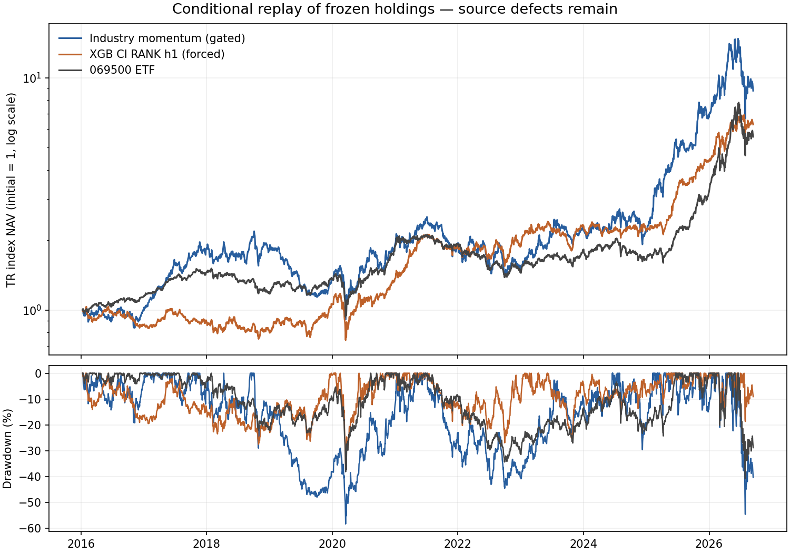

# ML 토너먼트 v1 독립 감사

**판정: RULE_INDUSTRY_MOMENTUM은 수정 후 재검증, XGB_CI_RANK_h1은 현재 투자 후보로 기각. 높은 과거 수익률 기록은 보존한다.**

감사 대상은 [PR #329](https://github.com/jaehojung1879-netizen/Investment/pull/329), HEAD `17404f86535f0b8a8992da451dc7667f00539dd6`이다. 시작 시 main은 `37f8cbf6b1c066f6b3c65235953648d17ebf2f69`였다. Fable의 PASS 판정과 독립 NAV 결과를 근거로 삼지 않고 원천 객체, 선택 기록, 계산 코드를 다시 조사했다. 이 감사는 새로운 모델 적합·역사 최적화·실행 승인·잠금 해제·production 변경을 하지 않았다.

## 1. 핵심 수치

평가: 2016-01-11~2026-09-14, 2,619 거래일, 140회 실행. 아래 CAGR은 제출물과 같은 **252 거래일 연환산**이다. 시작 가치는 모든 경로에서 1이며 시작 시 ETF를 보유한다고 가정한다.

| 전략 | 보고 CAGR | 독립 조건부 CAGR | ETF 대비 | MDD | Sharpe |
|---|---:|---:|---:|---:|---:|
| 전체 1위: RULE_INDUSTRY_MOMENTUM, gated | 23.273486% | **23.273508%** | +5.300763%p | −58.2758% | 0.691621 |
| 최우수 ML 민감도: XGB_CI_RANK_h1, forced | 19.363224% | **19.363224%** | +1.390478%p | −36.9817% | 0.763313 |
| 주 규칙 최우수 ML: LGBM_CIM_RANK_h3 | 15.980627% | **15.980638%** | −1.992108%p | −40.8055% | 0.630910 |
| 같은 선택·비중 규칙의 RIDGE_CI_RANK_a2, forced | 14.497985% | **14.498030%** | −3.474716%p | −48.2364% | 0.629783 |
| 069500.KS ETF | 17.972746% | **17.972746%** | — | −40.8055% | 0.706104 |

**“독립 조건부 CAGR”은 저장 비중과 고정된 총수익 지수 가격으로 다시 만든 값이다. 실제 주식 수량·배당 현금·결제·미체결 원장의 완전한 독립 재현 CAGR은 전부 `NOT_INDEPENDENTLY_REPRODUCED`다.** 이 둘을 동일시하지 않는다.

달력 경과연수로 연환산하면 산업모멘텀 **22.5839%**, XGB **18.7981%**, ETF **17.4511%**다. 이는 연환산 관행 차이이며 수익 경로의 불일치가 아니다. Sharpe는 저장된 BOK 기준금리 대용치를 사용한다.



원천 오류를 포함한 고정 경로의 그림이다. 투자 가능한 계정 성과의 인증이 아니다.

## 2. 독립 재계산 범위와 회계

`recompute.py`는 제출물의 `simulate`, `metrics`, `independent_nav`를 import하거나 호출하지 않는다. git의 원천 가격 객체를 직접 해제하고 해시를 검증한 뒤 총수익 지수 단위 보유량, 일별 평가액, 재거래 비용을 계산했다.

- 주 H126: **gated 148 + forced 148 = 296개 경로 전부** 재계산.
- 보고된 절대 TOP 10과 위험조정 TOP 10의 합집합: gated **10**, forced **12**, 총 **22개 보기·전략**. [전체 표](TOP10-ko.md), [CSV](top10-coverage.csv).
- 해당 TOP 10 합집합에서 최대 차이: CAGR **4.448e−7**, MDD **1.060e−6**, Sharpe **1.752e−6**, 연 주식 회전율 **1.249e−7**. CAGR 차이는 **0.0000445%p** 이내다. 저장 비중 반올림 오차와 부합한다.
- 전 경로 140회씩 저장 비중: 합계 **0.999998~1.000002**, 음수 비중 없음. 순서상 첫 실행일 종가 진입, 다음 거래일부터 수익 반영. ETF는 잔여 비중. 동일 종목·날짜 예측키 **16,800개 중 중복 0**.
- 원천 가격 객체 **378개**, 고유 KR 가격행 **844,269개**, 충돌·동일 중복 행 **0**. 원천 manifest의 decoded digest 및 모든 가격 객체의 content SHA-256 확인.
- 주식 총수익 지수를 쓰면서 현금 배당을 별도로 더하지 않았다. 그러나 원천 지수 자체의 중복 배당은 아래에서 **실제 반례**를 확인했다.
- 주식 회전율은 `Σ|주식 목표비중−직전비중| / 연수`다. 일반적인 편도 회전율과 같은 숫자가 아니다. ETF 포함 회전율도 아니다.

**보존되지 않은 입력:** 원래의 일별 NAV 전량, 실제 수량, 일별 현금·배당채권·ETF 수량, 실제 수수료 원장, 주문·미체결 기록, 원래 전체 주간 점수 및 H252 보유·fold 경로. 우승자 일부 월말 NAV/거래 종가와 전체 리밸런스 비중·양자화 예측 백분위는 있다. 따라서 원래 일별 NAV와의 최대오차를 독립 확인했다고 주장하지 않으며, H252 포트폴리오 성과도 독립 재현으로 세지 않는다. 감사의 `conditional-navs-*.csv.gz`와 `ledger-*.csv.gz`는 **이번 감사가 파생 생성한 기록**이지 사라진 원장 복원이 아니다. `trIndexUnits`는 실제 주식 수가 아니다.

**회계 반례:** 매매 불가 보유 종목에도 비용 차감 후 목표비중을 다시 곱하므로 거래 없이 보유 수량이 줄어든다. 산업모멘텀의 **2024-09-19 / 012450.KS**, XGB의 **2016-02-11 / 018880.KS**가 실제 예다. 별도 합성 테스트도 같은 결함을 재현했다. 수수료는 비용 차감 전 비중 차이에 부과하면서 수량은 비용 차감 후 NAV로 만들므로, 실제 거래대금 기준 수수료와도 다르다.

`check_cash.py`는 정지 종목 수량을 고정하고 실제 거래대금에 비용을 부과하는 자기자금 일치 방정식을 풀었다. 같은 기록 선택에서 산업모멘텀 **23.274777%**, XGB **19.362433%**, 자금 잔차 절댓값 **2.2e−15 이하**다. 이 회계 근사 오류의 영향은 이 두 경로에서 작다. 이 진단 역시 총수익 지수 단위 계산이며 실제 배당 현금 원장 재현은 아니다. 원래 결과를 대체하지 않는다.

## 3. 데이터·학습 감사 판정

PASS는 명시한 검사 범위에서의 PASS다. 반례가 없다는 것이 전수 빈티지 인증을 뜻하지 않는다.

| 요청 항목 | 판정 | 독립 확인·반례·남은 한계 |
|---|---|---|
| PIT 유니버스, 변경·퇴출 | **PASS (범위 한정)** | 원천 164 스냅샷, 구성 변경 163회, Top120-ever 260종목. 저장 예측 16,800키 모두 신호보다 엄격히 이전의 스냅샷 Top120에 포함. 전체 주간 714일×120=85,680행도 원천에서 재구성. 최신 생존 종목만 고정하지 않음. 월간 스냅샷 사이의 즉시 변화와 수집 당시 원본 응답 빈티지까지 인증하지 않음. |
| 공시 공개일 | **INCONCLUSIVE** | 실제 코드는 receipt/availableFrom < 신호일 필터를 적용하고 필터 후 TTM을 계산. 9,351 원천 공시 전부 수집일이 공개일보다 나중. 접수번호 날짜 불일치 2건은 기존 필터가 제외. 공개 당시 수치와 이후 정정의 모든 빈티지를 직접 대조할 원본 이력이 없어 “공시 PIT 전수 PASS”로 승격 불가. |
| 거시 발표 시점 | **INCONCLUSIVE** | BOK 기준금리 1종만 사용, 해당 날짜 이전 이벤트만 forward-fill. 미래 날짜 참조는 보이지 않음. 파일은 효력일·날짜만 있고 발표 시각의 당시 원본 증빙이 없음. 예: 2010-07-10은 토요일이라 이를 모두 “발표일”로 부르는 제출 설명은 부정확. 수정 거시 패널 전체를 검사했다는 의미 아님. |
| 배당·분할·주식배당·정정·기업행동 | **FAIL** | 006800.KS / 2026-03-16: fresh vendor/KRX 배율 변화 **1.00433526**, replay/KRX **1.00867635**. 이미 배당조정된 vendor에 현금 효과가 다시 들어감. 원천 기업행동 객체는 배당 300원, split 1.007321; 실제 주식배당 선언은 주당 0.0073206주. 단일 배당 인자로 전체 이력 수정을 인증할 수 없음. XGB는 2026-03-03 진입 후 이 사건을 통과. |
| 종결대가·거래정지·재개 | **FAIL** | 종료가 없는 라벨은 누락, 보유 종결은 0원 또는 최종가 전환. 측정된 합병·교환 대가가 아님. 최종가는 수학적 “상한”도 아님(대가가 최종가보다 클 수 있음). 거래정지 시 가상 수량 감소 반례도 있음. 두 우승 경로의 보고 terminal hit 0은 종결 회계 전반의 PASS를 뜻하지 않음. |
| H126/H252 라벨 성숙 | **PASS (달력·H126 저장 fold)** | 원천 가격·고정 달력에서 H126 **82,059**, H252 **78,511** 유효 라벨, 마지막 신호 **2026-03-06 / 2025-08-29** 재현. H126 1,692 fitted fold의 trainRows/trainDates/최종 종료일 전부 일치하고 종료일<첫 시험일. H252 성숙 산식 합성 테스트 PASS. 실제 H252 fold 기록 미보존은 별도 INCONCLUSIVE. 가격의 경제적 유효성 PASS는 아님. |
| 훈련·검증·평가 누출 | **INCONCLUSIVE** | 연별 훈련 라벨 purge와 게이트의 성숙 조건은 코드·재계산으로 확인. 실제 전체 모델 적합을 다시 하지 않았고 원본 전 주간 점수가 없음. 10개 순열의 평균 IC가 0에 가까운 것은 모든 형태의 누출 부재 증명이 아님. 미래 정보에 의한 특성 포함 결정은 다음 행에서 별도 FAIL. |
| 정규화·결측 대체·특성 선택 | **FAIL** | 순위는 날짜 내, z-score/시장 중앙값은 train-only. 그러나 `feature_layers(df)`가 **전체 2013~2026 결측률 ≥20%**로 열을 고름. “특성 선택 단계 없음”은 코드와 불일치. 2015 커버리지 0인 B01 등 23개가 전체기간 기준으로 포함. 미래 행만 추가해 과거 사용 열이 바뀌는 합성 반례 PASS. 다만 실제 84개가 모두 전체 기준을 통과했으므로 이것만으로 우승 수익률의 부풀림 크기를 주장하지 않음. |
| 동일 종목·날짜 중복 수익 | **PASS (저장 키·원천)** | 16,800 예측키와 844,269 가격행 중 중복 0; 원천 로더는 충돌을 거절. NAV는 종목별 단일 단위량. 전체 미보존 특성행렬의 중복 0까지 새로 확인한 것은 아님. |
| 모델 선택과 외부 평가 분리 | **FAIL** | 같은 2016~2026 성과로 1위를 고르고 같은 구간 수익을 보고. forced 보기는 결과를 본 뒤 추가. HP 사전 고정·연별 walk-forward는 최종 전략 선택의 외부 평가를 만들지 않음. 원래도 개발 증거로 표시한 것은 적절하지만 분리 자체가 성립한 것은 아님. |

추가 **주식 최종 가격 FAIL**: 고정 source commit의 2026-09-11/14 KRX 행을 직접 읽어 전일 replay/KRX 배율을 최종일 raw quote에 적용했다. 비교 가능한 235종목 중 **217종목의 최종 배율 차이가 0.1% 초과**다. 독립 재구성된 대조 최종가는 기존 별도 감사의 235개 정정가와 최대 차이 **0**이었다. 예:

| 2026-09-14 | 기존 replay 지수 종가 | 원시 KRX 기반 대조 지수 종가 | 차이 |
|---|---:|---:|---:|
| 000660.KS | 1,953,474.9195 | 1,969,724.8594 | −0.8250% |
| 009150.KS | 1,542,141.8480 | 1,559,639.6753 | −1.1219% |

최종 표시 가격만 고친 고정 선택 진단은 산업모멘텀 **23.429530%**(최종 NAV +1.3227%), XGB **19.404399%**(+0.3589%). **오류를 고치면 오히려 이 두 수익률은 약간 올라간다.** 이를 근거로 모든 기업행동·라벨·선택을 정정했다고 주장하지 않는다. 산업모멘텀에는 006800 직접 보유가 없으나 peer 산업 특성·학습 라벨 오염 영향은 남아 있다.

ETF는 삼성자산운용 원시 XLS 종가와 명시된 현금 분배 행으로 총수익을 새로 곱해 저장 benchmark와 최대 차이 **0**을 확인했다. 과거 배당 행은 기존 공식자료 추출값을 재사용했으며 모든 과거 PDF를 새로 파싱한 검증은 아니다. 배당세·지급 전 재투자 자금 조달은 ETF와 주식 모두 투자자 현금계정으로 검증되지 않았다.

## 4. 우연한 승자·전략 간 중복

검색은 주 H126 **141 ML + 7 규칙=148구성**, H252 **42구성**이다. 두 포트폴리오 보기를 합하면 **380개 경로 보기**가 노출되었지만 서로 독립적인 380회 실험은 아니다. 기존 저장소의 많은 역사 연구까지 포함한 총 탐색 수는 확정되지 않는다. 148만으로 모든 선택 편향을 교정했다고 볼 수 없다.

- 저장 보유와 양자화 예측을 독립 조사: forced 상위20 보유 Jaccard **0.1195**, 예측 순위상관 **0.3995**. gated **0.0975 / 0.3769**. 예측상관은 저장된 140개 리밸런스 날짜 범위이며 모든 주간 예측이 아니다. 모델 계열 차이를 독립 증거로 세지 않는다.
- ETF와 완전히 같은 경로를 작은 부동소수점 노이즈까지 전략으로 세지 않고 제외하면 gated 유효 nonzero active 경로 **143**, forced **147**. 고유값 참여비는 설명적 공통노출 지표일 뿐 독립 실험 수의 정답이 아니다.
- **Deflated Sharpe: 정식 검정으로 계산 불가.** 일별 직렬의존, 미확정 이전 탐색 수, CAGR로 고른 승자를 active Sharpe로 검사하는 목적 차이, 사후 forced 추가를 해결하지 못한다. 제출물의 iid 공식 수치만 재현하면 XGB 약 **0.0423**(float32), double 정밀·0 active 제외에서는 **0.0439**다. 산업모멘텀은 같은 처리에 따라 **0.1867→0.2699**로 바뀐다. “우연일 확률 96%” 같은 표현은 부당하다.
- 제출물은 NAV를 float32로 저장한 뒤 double ETF와 차감해, ETF와 같은 경로에도 가짜 active 변동을 만든다. 이 가짜 Sharpe가 전체 Sharpe 분산과 상관행렬에 들어간다. 정밀도와 영분산 처리에 민감한 DSR을 확정 증거로 채택하지 않는다.
- **PBO/CSCV: 정식 독립·purged 검정으로 계산 불가.** 16개 블록은 163일, 인접 구간 purge 없음, 10일 꼬리 제외, 순위 기준은 평균 active 수익이라 CAGR/Sharpe 대회와 다르다. 고정된 과거 학습 경로에 대한 시스템 진단일 뿐 개별 XGB의 과적합 확률이 아니다. 재계산한 설명적 PBO는 gated 약 **0.099**, forced **0.311**. float32에서는 약 **0.110 / 0.311**로 제출값에 접근/일치한다.
- H126/H252 주간 라벨은 약 26/52개 연속 주가 겹친다. 85,680행 또는 1,692적합을 독립 표본 수로 쓰지 않았다.

**동기화 시간 블록 진단:** 날짜를 공동 추출하는 126·252 거래일 원형 블록, 각 2,000회, seed 11. 아래는 **CAGR 차이가 아닌 연환산 산술 평균 일수익 차이**의 95% 구간이며, 사후 선택·가족 전체 교정은 아니다. 252일 진단의 유효 장기 블록 수는 대략 10개라 검정력도 제한된다.

| 비교 | 연환산 산술 평균 차이 | 126일 블록 95% 구간 | 252일 블록 |
|---|---:|---:|---|
| 산업모멘텀 − ETF | +8.3626%p | [−7.4346, +24.6919]%p | [−7.3878, +24.6005]%p |
| XGB − ETF | +1.0830%p | [−11.0604, +12.6355]%p | [−11.6917, +13.5180]%p |
| XGB − 같은 CI/RANK Ridge | 별도 JSON에 수록 | 약 [−3.23, +13.63]%p | 0 포함 |

**과최적화 위험: 높음.** 다수 탐색·사후 보기 추가, 산업/종목 집중, 비용 민감도, 선형 대비 구간의 0 포함이 함께 근거다. 낮은 검정력만으로 높은 실현 경로를 지우거나 “우위 없음이 증명됨”으로 해석하지 않는다.

제출의 과거 정보만 사용하는 연별 1위 교체 진단도 수익률 조각을 붙여 산업모멘텀 보기 **20.7395%**, forced 보기 **1.4475%**를 재현했다. 그러나 연초 기존 보유의 강제 교체·추가 거래비용·새 계정 시작을 처리하지 않아 **실제로 운용했다면 얻었을 수익률**로 인증할 수 없다. 해당 방향성은 경고 자료로만 남긴다.

## 5. 경제성, 실제 기여 종목·시기·조건

산업모멘텀은 규칙 자체가 산업/모멘텀 노출이다. “산업 안에서 무작위 5종목”이라는 설명도 정확하지 않다. 실제 점수는 `rank(H01) + 0.01*rank(A09)`로 **업종 내 상대모멘텀을 명시적으로 사용**하며 ticker로 동점을 푼다. 무작위 대조는 실행되지 않았다.

- 산업모멘텀 2025년 **+205.6241%**, ETF **+94.2069%**, 차이 **+111.4172%p**. 2025를 빼고 나머지 일수익만 연결하면 **11.8672% vs 11.8199%**로 거의 같다. 이는 실제 새 전략 운용이 아니라 연도 제거 민감도다.
- 누적 일별 기여 상위: **한화에어로스페이스(012450), 삼성전기(009150), SK하이닉스(000660), 한화오션(042660), 현대로템(064350)**. 기여 합은 각각 약 **0.4093, 0.4072, 0.3191, 0.2717, 0.2554**이며 CAGR 기여%p가 아니다.
- 2017 전기전자, 2025 방산·자본재 집중의 설명과 부합한다. 2025가 없으면 초과 CAGR이 약 **0.0472%p**뿐이다. 구체적인 미래 국면 예측력은 입증되지 않았다.
- 같은 기록에서 방산/자본재 보유분을 ETF로 대체하면 **15.3556%**, 전기전자 보유분 대체는 **16.6277%**, 상위5종목 보유분 대체는 **10.9743%**. 모두 ETF **17.9727%** 아래다.
- XGB의 기여 상위는 **SK스퀘어(402340), HMM(011200), 삼성전기(009150)**. SK스퀘어 보유분만 ETF로 대체해도 **17.4347%**, 상위5 대체는 **11.5245%**다. 기여 상위5에는 가격 기준이 거절된 **미래에셋증권(006800)**도 들어간다.

이 감사의 제거 민감도는 **제외된 비중을 ETF로 대체하고 새 종목을 고르지 않는 고정 선택 진단**이다. Fable의 “제외 후 다음 순위로 재선택” 수치(산업 상위5 제외 14.29%, XGB SK스퀘어 제외 15.74% 등)와 방법이 다르다. 그 요약치를 독립 재현했다고 주장하지 않는다.

증분 경제성:

- 같은 CI 특성·RANK 목적·forced top5를 쓰는 Ridge에 비해 XGB CAGR은 **+4.8652%p**다. 보고서의 **+4.69%p**는 연환산 산술 평균 일수익 차이인데 CAGR 격차처럼 읽힐 수 있다. 이 둘을 분리한다.
- 비선형 증분의 시간 블록 구간은 0을 포함한다. 별도 종목 예측력 A를 확인했다고 말할 수 없다.
- ETF·다른 규칙 전략의 수익을 요인 대용치로 회귀하면 XGB ETF beta 약 **0.9585**, alpha 약 **6.2795%/년**, HAC 126일 alpha t 약 **1.29**, R² **0.604**. alpha가 통계적으로 분리되지 않는다. 이 회귀는 독립적인 산업·규모 팩터 패널에 대한 중립화가 아니다. 특히 **규모 팩터의 독립적인 증분 검정은 입력 부족으로 계산 불가**다.
- 비용만 2배로 올리고 기록 선택을 고정하면 산업모멘텀 **20.5754%**(ETF +2.6026%p), XGB **16.8656%**(ETF −1.1071%p). Fable의 gated 20.85%는 비용을 바꾸면서 gate의 선택도 바꾸므로 순수 비용 효과와 구분해야 한다.

경제적 설명은 **E(혼합)**다. 산업모멘텀은 주로 **B(산업·모멘텀 노출)+C(몇 종목·2025 국면)**, 여기에 확인된 **D(가격·회계 오류)**가 있다. D의 확인된 최종일·현금 근사 영향만으로 높은 과거 수익을 설명할 수는 없다. XGB는 B/C와 불완전한 D가 섞였으며 A의 증분은 확인되지 않았다. SHAP/다른 모델 계열/특성군 제거만으로 A의 인과 증거를 만들지 않는다.

## 6. 고쳐야 할 파일과 이후 평가 범위

원래 파일과 결과는 수정하지 않았다. 다음은 수정 제안이다.

1. **P1 원천 무결성:** `prepare_dataset.py`, 라벨/portfolio price 생성 경로. 이미 보존된 `corrected-inputs.json`의 최종 가격·006800 유효성 거절을 검토하고 종목별 기업행동·종결 대가를 확정해야 한다. 유효하지 않은 종목을 미리 빼서 더 좋은 종목을 고르는 방식으로 수익을 세탁하지 말아야 한다. 선택된 가격 불명 종목은 해당 경제성 비교를 차단한다. 원래 결과는 원래 해시와 함께 보존한다.
2. **P1 감사 과장:** `audit_checks.py`, `independent_nav.py`, `REPORT-ko.md`. 전체기간 특성 선택, 미보존 H252 기록, 원시 지수와 실제 주식 수의 구분, 배당/종결 실제 반례를 반영해야 한다. 마지막 가격을 “상한”이라 부르지 않는다.
3. **P1 선택 추론:** `analyze.py`. 영 active 경로 제외, float 정밀도 보존, DSR의 가정/총 탐색 범위, PBO 시스템 범위·목적 차이·purge 한계를 공개해야 한다. 경로 이어붙이기를 실시간 재투자로 부르지 않는다.
4. **P2 회계 근사:** `tournament.py::simulate`. 실제 체결대금 비용과 정지 보유량 불변을 동시에 만족하는 자기자금 회계를 사용해야 한다. 이 두 경로에서 영향은 작지만 독립 재현기의 공통 근사도 고쳐야 한다.
5. **P1 후속 재현 자료:** 전 일자 선택·사전 목표·체결 가격·조정 전후 수량·현금·배당채권·ETF·비용·종결 이벤트, model/fold/feature 목록과 실행 커밋·환경을 묶어 저장해야 한다. 중단/재시작이 다른 code/config/input의 기존 예측을 조용히 재사용하지 못하게 해야 한다. 현재 `run_tournament.py`는 파일 존재만으로 skip하여 이 상태를 검증하지 않는다.

기대되는 평가 범위는 **동일한 이미 선택된 전략의 원천·회계 정정과 사전 고정된 전향 검증**이다. 원천 정정 뒤 1위를 다시 탐색하는 새 역사 최적화는 이번 승인 범위가 아니다. 잠금된 Phase C나 다른 연구를 재실행하지 않는다. 006800 전체 이력·종결 대가가 미해결인 동안 확정 “정정 CAGR” 하나를 제시하지 않는다.

## 7. 재현·환경·검사 기록

[고정 파일 해시](frozen-inputs.json), [시작 GitHub 상태](github-start-snapshot.json), [가격 객체 manifest](source-objects.json), [원천 검사](source-checks.json), [구조 검사](record-checks.json), [통계 진단](statistics.json), [현금 진단](cash-diagnostic.json), [모든 재계산](recalculation.json)에 증거를 보존했다.

- 원천 source commit `4ea107ed0cde289f0a049a65ff13d2441a786710`, 회계 commit `fb6e83743fd8cdba647d1522a4645b662a9d5647`.
- config SHA-256 `f990880562cd8ffb0c240ea2eb5742a40edb0a13dd27c46877310176fa0306bd`.
- replay manifest 내부 digest `f0781292f508a123c234ded6d28aa8e84a0dc3cc29500e14989dc0b68f53b4d2`.
- PR의 7개 커밋에서 config 선행 등록과 사후 forced 추가의 커밋 순서를 확인했다([기록](github-end-snapshot.json)). 원본 로컬 프로세스 로그·시작/종료별 실행 입력 증명이 없어 “첫 적합 전”이라는 실제 실행 시점까지 독립 인증하지 않는다. 원래 PR의 Actions Tests는 종료 확인 때도 in_progress였다.
- 전체 특성행렬을 22분짜리 builder로 새로 생성하지 않았으므로 제출의 matrix digest를 새 실행에서 재현했다고 주장하지 않는다. 모델 재적합도 하지 않았다. fold IC·SHAP·feature ablation 결과는 이번 독립 검증 범위가 아니다.
- H252는 성숙일/라벨 적격성은 재계산했지만 모델/포트폴리오 결과 전체 재현은 자료 부족이다.
- 환경: CPython 3.12, pandas 2.2.3, numpy 2.3.5; exchange-calendars 4.11.1. Fable의 CPython 3.13/pandas 2.3.0/numpy 2.3.1 적합 환경과 동일하다고 주장하지 않는다. 원시 가격/저장 선택에 대한 계산이다.
- 전체 `pytest -q`는 실행했으나 444.96초 후 범위 제한으로 중단: **2178 passed / 35 failed / 44 errors / 5 skipped / 3 xfailed**, 완주 PASS 아님. 주요 관측 원인은 shallow clone의 역사적 조상 commit 부재, 미설치 requests, sandbox PermissionError다. 모든 실패가 환경 원인이라고 판정한 것은 아니다. 관련 감사·원래 토너먼트 테스트는 별도 실행해 결과를 기록했다. 원래 연구의 전체 검사 PASS를 추인하지 않는다.
- `ruff check .`, compileall, seed 및 `pipeline.validate data/site-data.json --allow-seed`를 실행했다. seed 출력은 원본 복원했으며 변경 산출물은 감사 디렉터리와 감사 테스트뿐이다. 관련 테스트 **19 PASS**, ruff·compileall·seed/검증 PASS. 자세한 최종 결과는 [verification.json](verification.json).

```bash
# 추가 모델 학습이나 formal workflow 없이 저장된 경로만 검사한다.
git fetch --depth=1 origin 4ea107ed0cde289f0a049a65ff13d2441a786710 fb6e83743fd8cdba647d1522a4645b662a9d5647
# numpy/pandas/scipy, exchange-calendars==4.11.1, xlrd, pytest 필요
A=research/ml_strategy_tournament_independent_audit_v1
PYTHONPATH=. python "$A/recompute.py" --cache /workspace/audit-cache
python "$A/check_records.py"
PYTHONPATH=. python "$A/check_sources.py"
python "$A/check_statistics.py"
python "$A/check_cash.py"
python -m pytest -q tests/test_ml_tournament_independent_audit_v1.py tests/test_ml_strategy_tournament_v1.py
```

마지막 세 진단은 기본 `/workspace/audit-cache`를 읽는다. 캐시는 앞 단계에서 해시 검증한 동일 입력의 파생물이며, 처음부터 다시 검산할 때는 새 빈 캐시를 사용한다. 원래 Fable 스크립트의 main은 원 결과를 덮어쓸 수 있어 실행하지 않았다.

## 8. 사용자 결정

**산업모멘텀: 수정 후 재검증. XGB: 현재 투자 후보 기각, 기록 보존.** 앞으로 추적할 가치는 산업모멘텀의 큰 개발 성과·명료한 메커니즘에 있으나 우수한 종목 예측력의 확증은 아니다.

**다음 행동 하나:** 이 감사 PR을 근거로 **새 역사 탐색 없이 원천 오류와 완전한 거래 원장 저장만 보완하는 수정 작업**을 요청한다. 그 결과가 검증된 뒤에만 별도의 사전 고정된 무자금 전향 추적 여부를 결정한다.
