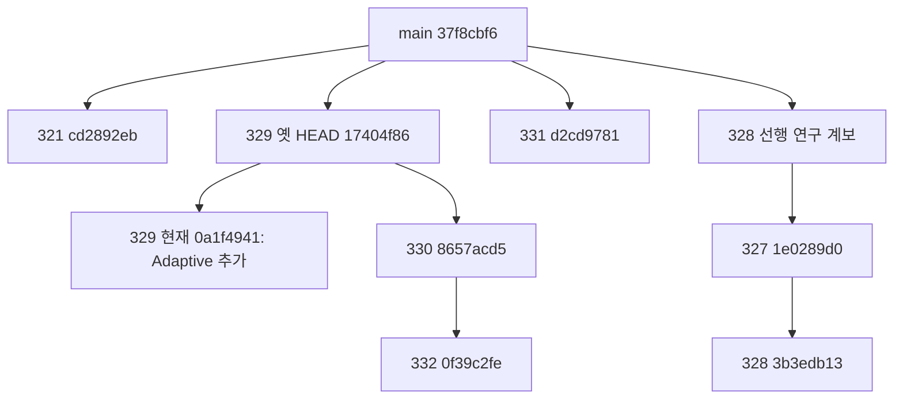

# Research Integration Audit & CI Recovery Decision

**ETF 현금회계의 산술과 공통 CI 장애 원인은 확인됐지만 주식 기업행동·US 환율 시점·미제출 웹 게시가 다음 단계의 병목이며, 가장 먼저 #321의 운영 변경까지 포함한 정확 HEAD의 일반 merge 승인 여부를 결정해야 한다.**

기준일: 2026-11-11 UTC. 판정은 **Needs revision / 범위 제한 검증**이다. 기존 PR·main·workflow·production·봉인·소비된 lock은 수정하거나 병합하지 않았다. 새 전략·토너먼트·백테스트·실제 학습·Actions dispatch도 없다. 저장 NAV의 산술, 기존 원장의 원천 대조, Git merge-tree 가상 충돌 검사와 합성 운영 테스트만 수행했다.

**이해관계:** lead는 #332 코드·결과 작성에 관여했다. 해당 검토는 **AUTHOR_REVIEW**이며 독립 외부 승인으로 부르지 않는다. #330도 기존 작성 계보의 증거로 취급하며 이를 재인용해 독립성을 증폭하지 않는다. 원저자 역할을 맡지 않은 같은 팀 second reader에게 #332를 별도로 넘겼다. 그 재계산은 아래 근거지만, 외부 비작성자의 원천·회계 승인 대체물은 아니다. [별도 검토](reviews/v2-second-reader.md).

## A. 연구별 확인된 성과와 한계

수익률은 각 연구의 원래 기간·연환산 정의를 유지한다. 서로 다른 시작일·현금/분배 정책의 CAGR를 한 순위표로 합치지 않는다. 아래 '산술 일치'는 원천 완전성·투자 적격 PASS와 다르다.

| 연구/대상 | 확인한 수치 | 검증 범위 및 승격 불가 사유 |
|---|---|---|
| ML v1 원형 산업모멘텀 / XGB forced / LGBM gated | 원본 **23.273486 / 19.363224 / 15.980627%** 보존 | 이미 노출된 역사에서 선택된 결과. 주식 총수익·권리·종결 완전성 미확인. 원본을 v2 인증 성과로 바꾸지 않음 |
| ML v2 ETF A | 2016-01-11~2026-09-14, 2,619일, **17.921480%**, 최종 **554,333,210.13원** | 공식 보존 종가·실제 거래량·분배 지급일로 별도 산술 일치. 소수 수량·세전 분배·초기 ETF 선보유·현금이자 0% 연구 약정. 시장 전체/실계좌 인증 아님 |
| ML v2 주식 3후보 A / B | 엄격 전기간 인증 **0개**, B 실제 적합 **0회** | A는 SOURCE_BLOCKED, B는 NOT_RUN. 조건부 TR 지수 진단 **23.430800 / 19.410264 / 15.979913%**는 확정 주주수익이 아님 |
| KR 원형 산업모멘텀 S1 | 2018~2026 위상0 CAGR **7.5621%**. 네 위상 ETF 격차 **−9.3955 / +2.5767 / −2.3674 / −5.0876%p** | 위상·시작기간 의존. 원 토너먼트의 2016 시작 23.3%와 기간이 다름. 우위 미확인 |
| KR 전략 모멘텀 | CAGR **32.445622%**; 위상별 ETF 격차 **+15.4880 / −5.8486 / +6.5617 / +6.5071%p** | 연도수익 연결 산술 일치. 일별 전체 장부 미보존. 위상0만 EW4 대비 구간이 0을 벗어남. 방산·전기전자 제외 시 격차 **+0.5917%p**. 탐색 가설로만 보존 |
| KR S2 가치·확인 | CAGR **18.628565%**, ETF 대비 **+1.6710%p** | 비용2배 격차 **+0.0401%p**, 2025년 제거 시 **+0.0015%p**. ETF 대비 구간은 모든 위상에서 0 포함. MDD −49.2281%로 ETF −40.8055%보다 깊음 |
| KR 상태 학습형 B1/B2/B3 | CAGR **5.1576 / 13.5155 / 9.8844%**; 저장 OOS R² 9개 모두 음수 **−0.8394~−0.0477** | 모델의 과거 학습·성숙 라벨 필터는 코드에서 확인. 예측/실제 라벨 원행이 없어 R² 자체는 독립 재계산 불가. 유용성 발견 실패이며 '모든 상태 예측 불가능'의 증명 아님 |
| US Track A USD 정적 S4 | 주 기간 CAGR **9.399%**, 확장 **8.067%** | 저장 월 NAV에서 13전략×2기간의 CAGR/vol/Sharpe/beta 등 산술 일치. 일별 전략 NAV 부재로 일별 MDD는 저장값만 확인 |
| US 동적 전략 | D1~D6의 CAGR 모두 S4 미달. 확장 D1 **6.719%**, D3 **7.268%**, D6 **7.382%** | 낮은 CAGR만으로 위험관리 기각 불가. 확장 저장 MDD D1/D3 −16.137%, D6 −17.749% 대 S4 −25.525%. 동일 위험 대조는 없음 |
| US KRW 성과/최근 배분 | KRW 동시점/PIT 주장 **FAIL**. '최근 배분'은 10-30 신호 / 11-02 실행 대상 | 미래 FX 적용과 실제 공표 지연. 원천 취득·결과 작성은 11-10이어서 10-30/11-02 전향 영수증으로 인정 불가 |
| US Track B 개별주 | 승인 **0세션**, 차단 유지 | 퇴출 신원/기업행동/종결대가 결함. 후보 가격 186,910세션 복구와 경제성 admission은 다름 |

US 주 기간은 첫 결정 2015-12-31, 첫 실행 2016-01-04부터 2026-10-30까지다. 확장은 첫 결정 2008-05-30, 첫 실행 06-02부터 같은 종료일까지이며 위기 전 고점 전체를 포함한 실험은 아니다.

### KR 재감사에서 판단을 바꾸는 근거

1. **공식 자료에도 큰 변동이 있다.** 새로 취득한 발행사 XLS와 보존본 3,612 공통세션의 종가·NAV 차이는 0원이다. 공식 raw 종가와 분배로 재구성한 TR도 저장값과 일치한다. 2026-07-31은 종가 87,635→108,820원, **+24.1741%**, 공식 NAV **+19.9694%**, 당일 분배 0원이다. 단순 TR 중복 배당이 만든 수치가 아니다. 그러나 발행사 자료의 일치가 KRX 체결·기초지수·모든 구성종목을 확인한 시장 사실 인증은 아니다. 비정상 구간의 경제적 설명은 미해결이다.
2. **ETF 대비 다중보정이 빠졌다.** 고정 config는 EW4·ETF 비교와 동적 6정책 Holm을 명시하지만 구현의 Holm은 EW4 비교에만 적용한다. 전략 모멘텀 ETF 대비 raw p=.031에 같은 6정책 Holm을 적용하면 **.186**이다. 이는 전체 토너먼트·네 위상 탐색까지 보정한 값도 아니다.
3. **006800의 선정 제외는 입력 복구와 다르다.** Cocktail은 원래 Phase B matrix `32e49b57…`를 사용하고 해당 종목만 선정에서 제외한다. 금융업 H01 등 간접 특성을 다시 만들지 않는다. 기존 복구 계보 `c3d66a99…`와 다른 입력이다. 복구 전 금융업 H01/H08 영향 13,465 member-date, 복구 후에도 2018 권리 경계 785행 미해결이라는 자료가 있다. 따라서 '기업행동 정정 완료 연구'로 게시할 수 없다.
4. **2025 제거는 사후 선택을 되돌리지 않는다.** 규칙은 결과 커밋보다 앞서 고정됐고 기존 config 키 변경도 없었다. 하지만 이미 알려진 2025 역사를 본 뒤 연구를 설계했다. 연도수익 한 행 제거는 그 해를 활용한 슬리브/설계 선택과 학습 이력을 지우는 독립 holdout이 아니다.

[KR 상세 검토](reviews/kr.md) · [저장 결과·공식 원천 검산](evidence/kr-checks.json).

### US 재감사에서 판단을 바꾸는 근거

- **환율 반례:** 2026-10-30 USD NAV에 다음 DEXKOUS 관측일인 11-02의 **1,344.51**을 적용했다. 10-30 관측값은 **1,333.99**다. Fed H.10은 전주 일별 환율을 다음 월요일 16:15 ET에 공표하며, FRED의 11-02 주간 자료 업데이트는 11-09였다. 관측일은 가용 시각이 아니다. 코드 `searchsorted(..., side='right')`와 `no-look-ahead` 설명이 충돌한다. FX는 USD 전략 신호가 아니므로 이 오류를 USD 성과 전체의 무효화로 확대하지 않는다. [Fed H.10](https://www.federalreserve.gov/releases/h10/), [FRED DEXKOUS](https://fred.stlouisfed.org/series/DEXKOUS), [구체적 근거](evidence/us-fx-publication.json).
- **평균 비중 대조의 분모:** 주 기간 131개 목표 중 마지막 목표는 평가 종료 후 11-02에 체결될 예정인데 twin 평균에는 포함됐다. 실제 기간 내 체결은 130개다. 이를 제외한 평균비중 최대차는 D1 **0.09689%p**, D3 **0.18849%p**다. twin NAV가 없으므로 성과 수정 크기는 미확정이다.
- **지표 혼용:** README의 연율화 산술평균 차이와 CAGR 차이는 다르다. 확장 D1/D2의 twin 대비 CAGR 격차는 **+0.023/+0.003%p**, 산술차는 **−0.020/−0.010%p**다. '모든 타이밍 효과≤0'이라는 무단위 표현을 고쳐야 한다. 작은 양수가 유의한 알파라는 뜻도 아니다.
- **원천 검증 범위:** 원천 20파일 해시와 ETF8의 TR 재구성은 같은 Yahoo 내에서 일치한다. SPY/QQQ와 FRED 지수는 각각 2,469세션의 제한된 가격 대조다. 이전 Yahoo snapshot은 독립 vendor가 아니다. IEF/TLT/SHY/BIL/GLD/UUP 6개의 독립 가격·기업행동 검증과 ALFRED vintage는 미확보다.
- **위험관리:** 평균 target twin은 같은 실현 vol/beta 대조가 아니다. 확장 D1/D3/D6의 저장 방어 효과는 보존한다. D4/D5는 2008 당시 S4 fallback이었고 첫 실제 모델 decision은 2013-06-28이다. 금융위기를 ML이 예측했다는 결론은 성립하지 않는다.

[US 상세 검토](reviews/us.md) · [원천·월 NAV 검산](evidence/us-checks.json). 기존 전체 투자가능성 FAIL/미검증 항목을 원본 연구의 삭제 사유로 사용하지 않는다.

## B. PR별 실제 HEAD·base·CI

모두 open draft다. SHA는 표에서 축약하며 [완전 SHA·변경 파일 목록·CI](evidence/github-snapshot.json)에 고정했다.

| PR | HEAD | base SHA / branch | 자체 변경 | 최신 동일 HEAD Tests |
|---|---|---|---:|---|
| #321 | cd2892eb | 37f8cbf6 / main | 29 | **SUCCESS** 42369756685, 6,521 passed |
| #328 | 3b3edb13 | 1e0289d0 / claude/trusting-tesla-ob0jym | 40 | **FAILURE** 42786379740 |
| #329 | 0a1f4941 | 37f8cbf6 / main | 55 | **FAILURE** 42916758982, 1 failed / 6,448 passed |
| #330 | 8657acd5 | 17404f86 / claude/ml-tournament-audit-vddc20 | 29 | **FAILURE** 42833560860 |
| #331 | d2cd9781 | 37f8cbf6 / main | 41 | **FAILURE** 42918585243, 1 failed / 6,436 passed |
| #332 | 0f39c2fe | 8657acd5 / codex/ml-tournament-independent-audit-20261110 | 95 | **FAILURE** 42924312276, 1 failed / 6,474 passed |

#332의 이전 보고 시점에는 CI가 진행 중이었지만 현재는 실패로 끝났다. 이번 감사는 그 상태를 최신화한다. #328/#330은 이번에 HEAD 상태를 다시 읽었으며 지정된 다른 네 실패 로그와 달리 그 두 run의 로그 전체를 다시 해석한 것으로 과장하지 않는다.

main은 `37f8cbf6` 그대로다. 지정 Pages run **42854235760**과 최근 완료 **42948385875**는 각각 **1 failed / 6,423 passed**로 Tests 단계에서 실패해 deploy·state publication이 skipped였다. 더 최신 **43005376371**은 최초 관측 때 진행 중이었으나 **11:15 UTC 최종 조회에서는 FAILURE**였다. 그 실제 로그에서도 threadpoolctl3.8.0 / PINNED_DEPENDENCY_VERSION_REQUIRED의 같은 실패를 확인했다. [최종 상태](evidence/github-closing-snapshot.json), [최신 로그 발췌](evidence/latest-main-ci-excerpt.json). [Pages job 상태](evidence/pages-status.json).

## C. 공통 CI 장애와 정확한 복구 경로

지정 #329/#331/#332/main Pages 로그 네 건 모두 설치된 **threadpoolctl 3.8.0**과 등록값 **3.7.0**이 충돌한다. 실제 실패는 `test_runtime_restriction_and_cli_bootstrap_order`다. 해당 테스트는 먼저 single-thread 거절을 기대하지만 runtime은 그보다 앞선 버전 검사에서 `PINNED_DEPENDENCY_VERSION_REQUIRED`를 발생시킨다. 즉 테스트 삭제나 숫자 허용오차 확대가 필요한 실패가 아니다.

#321 성공 run은 **threadpoolctl 3.7.0 / joblib 1.6.0**을 설치해 6,521개를 통과했다. 기존 `requirements.txt`, formal interpreter/CPU/thread 제약, 원래 수치 기대값은 그대로다. 일반 Tests와 production Pages install에만 같은 constraints를 적용한다.

다만 단순 pip 두 줄만 이식하면 Pages 전체 파일을 봉인한 보호 검사를 깨뜨릴 수 있다. #321은 별도 exact-hash maintenance record와 bounded byte transformation으로 그 운영 변형을 검증한다. 승인하지 않은 workflow 변경, 재서명한 우회, formal 변경, 수치 기대값 수정은 별도 음성 테스트에서 거절된다.

새 격리 checkout에서 운영·보호 검사 **107 passed**를 재실행했다. 첫 실행은 과거 `23522002:pages.yml` Git blob 미확보로 **34 failed / 73 passed**였고, 정확 과거 blob만 읽기 전용으로 확보한 후 전부 통과했다. 코드/테스트/기대값은 바꾸지 않았다. 이 실패도 보존하며 Git 계보·객체 가용성이 실제 복구 조건이라는 반례로 삼는다. [처음 로그](evidence/ci-focused-first.log.gz), [재검사](evidence/ci-focused-recheck.log.gz), [Actions 원문 로그 해시](evidence/ci-log-identities.json).

## D. #321 병합 적격성 및 별도 승인

**판정: 정확 HEAD cd2892eb에 한해 기술적으로 조건부 적격이다. 이번 지시에는 병합·배포 승인이 없으며 명시적으로 금지되어 실행하지 않았다.**

| 검사 | 확인 | 남은 운영 조건 |
|---|---|---|
| production state 보존 | deploy·production validation 뒤 `state/latest.json` 한 경로만 base-tree API commit | 실제 production 실행에서 이전/이후 state·ledger tree와 신선도 확인 필요 |
| signal-history 동시 쓰기 | inspected HEAD 단일 parent, `force:false`, 409/422만 최대5회 fresh-read 재시도. concurrent ledger append와 newer state 거절 테스트 PASS | 원격 branch policy·token 권한·실제 동시 writer 환경까지 실증한 것은 아님 |
| Pages 정상화 | 현재 Tests 단계의 공통 원인을 제거하는 경로 확인 | #321 Pages SUCCESS 42369756681은 **matrix-diagnostic만 성공**, build-and-deploy는 skipped. production deploy 성공 증거가 아님 |
| 연구 봉인 | 원래 보호파일 **235개 변경 0**, formal job bytes·requirements bytes 불변 | research diagnostic prefix는 실제로 변경됨: consumed study의 full-input preflight 대신 closed provenance. 이것은 진단 의미의 변경이지 새 실행 preflight PASS가 아님 |
| 실행 권한 | formalExecutionAuthorized=false, consumed tag 2개 모두 09ba076f. 새 승인/해제/재실행 경로 없음 | 기존 승인으로 소비된 연구를 되살리면 안 됨 |
| 역사 Git 객체 | parent **23522002**, reference main **37f8cbf6**, consumed **09ba076f**를 실제 읽음 | **plain merge + 필요한 전체 역사 객체 유지**. squash/rebase·얕은 객체 누락은 동일한 실패를 재발시킬 수 있음 |

기존 workflow 테스트에서 Owner/formal 관련 개별 assert 문 일부는 실제 교체됐다. 이를 '테스트가 전혀 바뀌지 않았다'고 설명하면 안 된다. 대신 exact current workflow와 제한된 변환·formal job 불변·공격적 재서명 거절로 검증한다. 이번 검토에서 수치 코드/기대값을 느슨하게 만든 증거는 없었다. 원래 preflight 자체도 여전히 consumed 상태를 거절한다.

**추가 승인 대상:** Owner가 정확 HEAD·maintenance record·post-merge 일반 Pages 배포 및 state writer 동작을 포함하는 운영 merge 범위를 승인해야 한다. 문서에 있는 A/B 구현·테스트 동의는 main merge/실제 게시/전향 writer 활성화 동의와 다르다. #321은 종속성 두 줄보다 큰 29파일 변경이므로 이를 한 항목으로 숨기지 않는다.

승인 후 합격 조건은 새 main의 원격 전체 Tests, 정상 production validation→deploy→state publication, 신선도 비퇴행, state 외 signal-history subtree 불변이다. 실패하면 기존 유효 state를 보존하고 원인을 공개한다. consumed lock 초기화·force push·테스트 우회는 복구 방법이 아니다.

## E. 실제 계보와 통합 방법

현재 #329는 #330/#332의 조상이 아니다. #330은 #332의 조상이다. 옛/새 #329의 ML v1 subtree SHA는 모두 **949478eb852c4f4bd15d55685fafac92f6b7c187**다. 새 HEAD에서 추가된 것은 Adaptive 파일10개와 테스트1개이며 원 ML 파일은 동일하다. 그러므로 #330/#332의 frozen 원본을 갈아끼울 필요는 없고, 그 감사가 새 Adaptive까지 검토했다고 표현해서는 안 된다.

여섯 PR 자체 patch의 경로 교집합은 0이다. 누적 순서 **321→329→330→332→331→328**의 `merge-tree` 가상 검사는 모두 충돌 0이었다. **Git tree 충돌 없음은 결합 CI PASS·운영 승인·수치 적격성의 증명이 아니다.** refs/index/working tree를 병합하지 않았으며 테스트용 unreachable Git object만 만들었다. [정확 계산](evidence/lineage.json).

권고 통합 경로는 다음과 같다.

1. Owner가 #321 운영 범위를 승인하면 **plain merge**로 역사 계보를 유지하고 새 main CI/정상 Pages 경로를 확인한다.
2. #329 작성자가 새 main을 자기 브랜치에 일반 merge해 constraints와 보호 변형을 반영하고 CI를 재확인한 뒤 병합한다. Adaptive의 새 한계/정정은 별도 errata로 표시한다.
3. #330은 #329가 main에 들어온 뒤 **base를 main으로 retarget**하고 새 main을 merge한다. 기존 17404f86 감사의 범위·해시는 유지한다. #332도 #330 병합 후 같은 방식으로 retarget/merge하며 기존 결과를 재생성하거나 덮어쓰지 않는다.
4. #331은 #321 이후 독립적으로 통합할 수 있다. #329를 선행시켜야 할 계산 의존성은 없다. FX·대조군·시점 표기 errata와 CI를 확인한다.
5. #328은 별도 상위 계보다. PR 자체40파일이지만 main 대비 **218파일**을 포함한다. 선행 #320/#322/#327 등 전체 인수 범위·전향 writer 영향을 재승인하기 전 통합하지 않는다. #332의 세 vendor 원천/함수는 exact byte로 보존되어 있으므로 #328 전체 merge가 #332의 선행조건은 아니다.

#321 변경과 #332의 실행 code closure 115파일·#330 frozen input closure의 교집합은 0이었다. 따라서 그 정확 범위에서 원래 경제성 결과를 고칠 이유는 없다. 다만 commit identity와 앞으로의 환경/packet은 바뀌므로 재실행은 새 identity로 다뤄야 한다. 모든 결합 브랜치의 전체 CI를 이번 감사가 돌렸다는 주장은 하지 않는다.

## F. ② 웹 게시 구현과 선행 조건

**현재 판정: NOT_SUBMITTED.** 최근 PR 50개, 여섯 PR 변경 목록과 main frontend의 데이터 연결을 확인했다. main에는 기존 P0/P1/C1/C2 및 #298의 '마지막 C2 기록 비중' UI가 있지만, 이번 KR/US Cocktail·ML v1/v2를 구분해 게시하는 ② 구현 PR은 없다. 기존 #299/#307/#314의 다른 연구 공개 작업을 이번 ②의 완료로 세지 않는다. 로컬 미제출 초안의 존재까지 부정하는 NOT_STARTED 판정은 하지 않는다.

게시 계약은 네 타입을 분리한다.

| 타입 | 허용 표시 | 필수 차단/시점 |
|---|---|---|
| HISTORICAL_EXPLORATORY | 원래 탐색 CAGR·기간·선택편향·원천 한계 | '현재 기대수익/추천'으로 변환 금지 |
| CORRECTED_CASH_SCOPE | 인증한 source scope·회계 약정·정정 버전의 성과 | 조건부 TR 지수를 이 타입으로 취급 금지 |
| SOURCE_BLOCKED | null 성과, 사유·영향 구간·감사 링크 | 0% 대체·가상의 최신 평가액·투자 PASS 금지 |
| RESEARCH_ALLOCATION_AS_OF | 명시적인 과거/새 전향 receipt의 종목·비중·잔여 ETF/현금 | signalAsOf, informationCutoff, generatedAt, executionAt, publishedAt, source/model hash, freshness 각각 필요 |

KR의 자료 종료 **2026-09-14**, 마지막 신호 **09-04**와 US의 **10-30 신호/11-02 예정 실행**을 **11-11 최신 추천**으로 표기하지 않는다. generatedAt이 없으면 커밋시각을 그 필드의 실제 영수증으로 대신 채우지 않는다. 실행일 뒤 생성된 배분은 역사적 재구성이다. 최신 완료 거래일과 생성·공개 기한을 맞추지 못하면 '과거 연구 기록'으로만 표시하며 현행 추천 카드에서는 차단한다.

원래 production 가중치·후보·signal-history writer·sealed UI/빌드 해시를 자동 변경하지 않는다. 기존 publication의 stale/validation gate를 유지하고, 보호 파일 접점이 있다면 구현 전에 별도 bounded 승인 범위를 정한다. 웹 게시 자체는 모델 승격이나 거래/전향 writer 활성화 승인이 아니다.

## G. 154종목 대신 경제성 우선 복구

154는 A의 원래 선택 합집합이다. 원래 보유와 연결한 관찰 가능한 사건/경계는 후보별 중복 포함 **146행**, 종목×사건일로 **135개**, **62종목**이었다. vendor flag가 없는 사건도 있으므로 이 수를 전수 기업행동으로 세지 않는다. B의 훈련 모집단을 이 집합으로 줄이지 않는다.

원문을 이미 일부 확보한 2026 패키지는 재사용 비용이 낮고, 018880은 다중 날짜의 법적 연결이 필요하며, 2018 비상장 권리의 가치/정산은 원문이 있어도 복구 난도가 높다. 이 비교는 작업량 실측이 아닌 현재 증거에 근거한 우선순위 판단이다. 금액은 원시 실물 계정으로 확정할 수 없다. 1억원 시작의 v1 TR 원장을 환산한 조건부 참고 노출은 사건 직전 018880 **19,708,359원**, 005930 **18,012,909원**, 006800 2018 **17,257,215원**, 2026 **112,187,597원**이다. 이는 인증된 실제 원시 주식 평가액이 아니며 [원행과 산식](evidence/event-reference-amounts.json)을 따로 보존했다. 아래 20%는 원래 목표, 직전 비중은 **v1 조건부 TR 원장의 value/NAV**다. 검증되지 않은 실제 보유 금액을 만들어 채우지 않았다. [모든 보유 사건행·기간·가치](evidence/v2-calculations.json).

| 우선 | 사건·원래 보유 | 비중/원천 | 정보가치와 다음 판단 | 사건 단독 해결 시 추가 인증일 |
|---|---|---|---|---:|
| 1 | **018880 / 2016-01-21** vendor split5; XGB·LGBM, 01-11~03-07 | 원래 각20%; XGB 직전20.2323%. KRX 종가52,500·주식106,760,000, 01-22~02-15 거래량0, 02-16 10,200·주식533,800,000 | 두 후보의 첫 장벽을 공유. 공식 효력·입고·정지·재개 패키지부터. vendor 날짜에5배 수량을 넣으면 거짓 약5배 평가를 만듦. 선행 조건을 붙인 추가 관찰 달력 상한 XGB106/LGBM168일이며 인증일이 아님 | **0** |
| 2 | **005930 / 2016-06-29** vendor cash1000; 산업,06-27~09-19 | 목표20%, 직전20.0404%. 공식 금액·권리·지급일 패키지는 미채택 | 산업의 첫 장벽. 공식 보통주 DPS·지급일 확보 비용 대비 관찰 확대 가능성 높음. 달력 상한62일, 누락 없음 입증은 별도 | **0** |
| 3 | **006800 / 2018-01-23** 비상장 우선주 신주인수권; XGB,01-15~03-12 | 목표20%, 직전20.1475%. 공식 배정0.1979557317·발행가5,000원은 존재하나 권리 가치/정산 미확정 | 단순 배당/분할 flag 밖의 실제 보유 경계. 가치·처분/행사 정책을 확인할 수 없다면 정확 전체 CAGR 복구를 중단할 판단점. 발행가/가격비율/0원 대체 금지 | **0** |
| 4 | **006800 / 2026-03-16** 현금300+주식0.0073206; XGB,03-03~03-30 | 목표20%, 직전21.0730%. 공시 조건·04-22 추가상장 근거 있음 | 기존 공식 모듈 재사용 가치가 높음. 경제적 하루 배수1.031928496978. 실제 cash/주식채권 원장 연결과 추가상장≠계정 입고를 분리 | **0** |

그 다음은 012450의 2024 주식수 조정/정지·신설주 대가 종류 확인, 010120의 2026 분할·재개 패키지다. 단순 multiplier 추정부터 하지 않는다. 선택된 종목 중 raw quote가 cutoff 전에 끝난 5종목은 원래 보유/예정 매도창이 그 이전에 종료돼 그 창의 quote 누락은 0이었다. 따라서 이 5종목의 종결 서류 전수 수집이 현재 A의 첫 병목은 아니다. B의 훈련 label에는 별도 종결 문제가 남는다.

**인증일 0은 복구가 무가치하다는 뜻이 아니다.** 개별 사건은 현재 조건부 관찰/오류 규모와 복구 가능성을 알려주지만, 전기간 cash/action/terminal 완전성 미입증을 해제하지 못한다. 표의 관찰 상한을 합산하거나 수익 개선으로 읽지 않는다. 먼저 1·2의 작은 공식 패키지를 만들고 3의 해결 가능성을 판정한다. 2018 권리 등 경제성을 끝내 확정할 수 없다면 '과거 전체 미인증'을 남겨 닫고, 새 전향 기록은 별도로 시작한다. 연구 프로그램 전체를 154종목 완수까지 멈추지 않는다.

## H. 외부 독립 검토로 넘길 잔여 항목

| 대상 | 담당 | 넘길 근거/결정 | 현재 상태 |
|---|---|---|---|
| #332 원천 admission·기업행동·정지/재개/수량·배당채권 | **작성에 관여하지 않은 금융 데이터/회계 reviewer** | 위 사건 원문, 원시 KRX, 45파일 manifest, 8개 계정, 입력 identity. 실제 사례가 통과한 원장까지 확인 | AUTHOR_REVIEW + 같은 팀 second reader; 외부 승인 미완료 |
| #332 문서 입고 표현 | #332 작성자 + 위 reviewer | '실제4월입고'를 '추가상장 자료 및 일반 합성 지연입고 검사; 실제006800 연결 미완성'으로 한정하는 errata | 원본 수정 안 함. **작성자 표현이 증거보다 강했음을 인정** |
| KR 이상 ETF 자료·모델 추론 | 비작성자 시장원천/통계 reviewer | KRX·기초지수 독립 대조, 위상 원행 NAV/OOS prediction·label receipt, 다중보정 | 공식 발행사 재대조까지만 확인. 없는 원행을 새 적합으로 메우지 않음 |
| US 원천·FX·대조군 | 비작성자 시장데이터/통계 reviewer | 비주식ETF6 독립원천, release/vintage, 미체결목표를 제외한 twin 정의, 동일 위험 비교의 부재 | USD 산술과 주장 범위 분리; KRW PIT 미인증 |

## I. 즉시 추진할 개발 작업 — 최대 3개

| 작업 | 담당자 | 변경 범위 | 필요한 승인 | 완료 조건 |
|---|---|---|---|---|
| **1. CI/Pages 복구와 연구 계보 통합** | repo 운영 maintainer, 비작성자 CI reviewer, 각 PR 작성자 | 정확 #321 일반 merge 제안·역사객체 보존, 위 E의 retarget/merge·결합 CI. #328 넓은 계보는 별도 유지 | Owner의 main merge·정상 Pages/state writer 운영 범위 승인. **이번에는 미승인/실행금지** | 새 main 전체 Tests와 정상 Pages→검증→deploy→state 게시 확인, ledger subtree 보존, 모든 frozen 연구 해시 유지 |
| **2. 연구 정합성 errata와 ② 읽기 전용 게시** | Fable 연구 작성자 + 웹 maintainer + 데이터 reviewer | KR Holm/계보, US FX·twin·산술/CAGR·생성시점, #332 입고 표현을 원본 밖 errata로 연결. F 계약의 네 타입·날짜/차단 카드·기존 view 보존 | Owner의 UI/게시 범위 및 보호 접점 승인. 원래 수익률 재작성·새 fit·배포/전향 writer 자동 활성화는 포함하지 않음 | 09-14/10-30 자료가11-11 추천으로 보이지 않음, null/차단 누락 없음, 출처/시점 통합 테스트, 기존 UI 회귀·신선도 gate PASS. 원래 결과 파일 해시 불변 |
| **3. 경제성 우선 사건 소규모 복구 및 외부 #332 검토** | 원천 담당 + 비작성자 회계 reviewer | 018880·005930 패키지 우선, 006800 2018 권리 해결 가능성 판정. 공식 원문·중복/정정/효력/지급·재개를 작은 versioned packet에 저장 | 공개 원문 조회·합성 검사 범위. 유료 원천/권한 필요 시 별도 승인. 실제 과거 B 재적합은 fresh exact packet/Owner 승인 및 source gate가 별도로 필요 | 사건별 VERIFIED/UNRESOLVED와 경제성 영향/추가 관찰 한계·미인증을 기록, 잘못된 날짜 배수 반례 거절, 외부 reviewer 서명. 전체154 수집이나 새 우승자 선정이 종료 조건이 아님 |

이 세 작업 외에 새 장기 연구 프로그램을 제안하지 않는다. 데이터 차단이 남았다는 이유로 CI/정확한 과거 공개/새 전향 기록까지 하나의 대기열에 묶지 않는다.

## J. 다음 6~12개월 전향 검증의 최소 조건

1. **Owner가 기존 후보·목적을 선택하고 사전 고정:** 최대 소수의 기존 규칙과 ETF 대조군, 리밸런스 위상·수량/비용·위험 목적·시작일·중단 기준·재학습 여부를 고정한다. 알려진 2025 수익률을 새 확인 표본으로 재사용하지 않는다. 자금 없는 연구 기록이며 투자 승격 승인과 분리한다.
2. **시점이 실제로 남아야 함:** informationCutoff≤generatedAt<첫 실행, 공개/소스 취득시각·release availability·수정 이력·모델/설정/source hash를 append-only receipt로 보존한다. 지나간 배분을 소급해 전향 row로 넣지 않는다.
3. **관찰 경제성을 재구성할 최소 원장:** 실제 사용 가능한 가격과 권리·정지·미체결·ETF/현금·배당채권·비용을 기록한다. 미확정 사건은 source-block 또는 사전 정의한 구간으로 보고하며 종목/날짜를 사후 삭제하지 않는다. 현행 입력의 적격성을 확인하되 과거154개 전부 복구를 시작 조건으로 삼지 않는다.
4. **비교를 사전 정의:** 같은 기간 ETF, 평균 노출과 위험관리 목적의 차이, 원화 표의 공표시각 처리, 비용 스트레스와 실패/누락률을 미리 정한다. USD 성과와 KRW 비동기 환산을 섞지 않는다.
5. **6~12개월은 검정력 한계를 공개:** 소수 월별 결정과 겹치는 H126/H252 관측을 독립 표본 수로 부풀리지 않는다. 먼저 시점·원천·회계·운영 신뢰성과 위험 행동을 평가한다. 양의 수익이나 한 번의 방어로 알파·투자 적격 PASS를 자동 발급하지 않는다.

## 검증 범위와 보존물

전체 연구가 완전 재현됐다는 판정은 아니다. KR은 공식 ETF 재구성과 저장 연도수익 연결, US는 raw source/TR 및 저장 월 NAV 통계, #332는 작성자 이해관계를 공개한 별도 원장 산술, CI는 지정 로그와 exact #321 운영 테스트를 확인했다. 일별 전략 장부·OOS prediction·모든 원천/vintage가 없는 부분은 미검증으로 남겼다. 새 전략/백테스트/실제 fit/Actions dispatch/소비된 lock 쓰기는 **0회**다.

주요 근거: [Git/PR/CI 스냅샷](evidence/github-snapshot.json), [가상 충돌/계보](evidence/lineage.json), [235 보호파일 검사](evidence/protected-321.json), [KR](reviews/kr.md), [US](reviews/us.md), [v2 second reader](reviews/v2-second-reader.md). 입력 경로·실행 기록과 최종 파일 해시는 README 및 manifest에 남긴다. Git tree의 합치나 CI 녹색은 연구 경제성 승격이 아니다.
