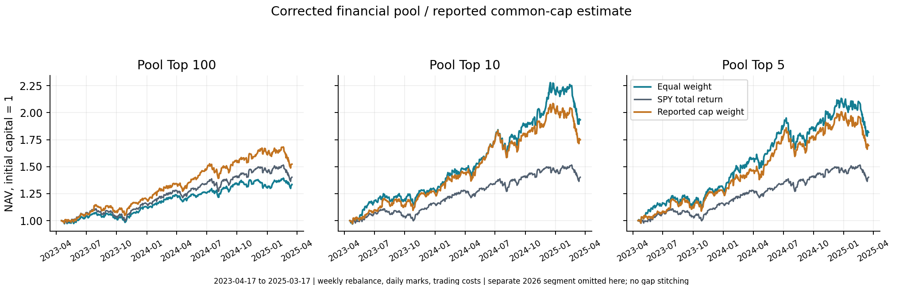

# 미국 Top 100·10·5 성과 및 과거 확장 점검

**전체 S&P 500의 검증된 Top K 성과는 아직 0주다. 아래 수익은 기존 정정 재무 풀의 총시총 추정 Top K다.** 신호 2023-04-14~2025-03-07의 성숙 100주에서 계산했다. 금융·부동산과 네 재무 요인의 배제를 주 실험에 적용하지 않았으며, 주 실험은 미검증 순위 때문에 보류했다. 별도 재무 풀은 기존 입력의 제약을 그대로 표시했다.

main 기준 `4f4497bcc9e7f9369bf5529225585ad39b0d7725`, 독립 worktree. 연구 결과는 이미 노출된 입력을 재사용한 탐색적 기술통계이며 새로운 표본외 검증 또는 투자 가능성 주장이 아니다. 원본·키·공용 원장·봉인 결과·main·화면·writer를 변경하지 않았다.

## 첫 성과표

SPY 달러 총수익 대비 비용 차감 초과수익. 평균·중앙값·하위 10%는 %p, 승률은 %. 연율화하지 않았다. 동일 K의 두 가중 방식은 같은 회사 순위·날짜·증권을 쓴다.

| K | 기간 | 가중 | 성숙/완전 | 평균 | 중앙값 | 승률 | 하위 10% |
| --- | --- | --- | --- | --- | --- | --- | --- |
| 100 | H126 | 시총 | 100/100 | +1.99 | +1.10 | 75.0 | -1.29 |
| 100 | H126 | 동일 | 100/100 | -1.86 | -1.73 | 19.0 | -4.36 |
| 100 | H252 | 시총 | 100/100 | +3.29 | +2.75 | 80.0 | -1.71 |
| 100 | H252 | 동일 | 100/100 | -4.23 | -4.18 | 11.0 | -8.64 |
| 10 | H126 | 시총 | 100/100 | +6.19 | +5.28 | 83.0 | -1.19 |
| 10 | H126 | 동일 | 100/100 | +7.08 | +6.44 | 88.0 | -0.43 |
| 10 | H252 | 시총 | 100/100 | +11.27 | +11.60 | 95.0 | +2.49 |
| 10 | H252 | 동일 | 100/100 | +15.50 | +13.92 | 99.0 | +4.69 |
| 5 | H126 | 시총 | 100/100 | +5.95 | +5.46 | 80.0 | -2.79 |
| 5 | H126 | 동일 | 100/100 | +8.08 | +6.63 | 77.0 | -2.67 |
| 5 | H252 | 시총 | 100/100 | +9.15 | +10.39 | 88.0 | -0.93 |
| 5 | H252 | 동일 | 100/100 | +13.77 | +11.88 | 91.0 | +1.05 |

Top 100의 동일가중은 두 기간 모두 SPY를 밑돌았다. 이 표본에서는 집중한 Top 5·10과 시총가중의 평균이 더 높았다. 재무 풀에 조건부인 결과로 전체 지수 선정 효과를 입증하지 않는다.

## 계산 전에 고정한 규칙

회사 CIK로 합치고 복수 클래스 회사를 한 번만 순위에 넣는다. 보유 증권은 당시 지수 편입 클래스 중 사전순 첫 심볼이다. Alphabet은 A/B와 C의 가격을 구분하고 B를 A 1주로 환산한다. Berkshire A는 B 1,500주, Erie B는 A 150주의 경제적 권리 기준이다. 미상장 클래스의 경제적 동등 가격은 추정이며 실제 거래가격 또는 유동시총이 아니다. Up-C LLC 권리 연결이 불명확한 TKO·CVNA·IBKR은 순위 공백으로 남긴다.

시총은 신호일보다 앞서 공개된 실제 보통주 발행주식 수와 신호일의 분할 전후가 일치하는 실제 종가를 사용한다. EPS 가중평균 주식 수를 쓰지 않는다. 주식 수는 최근 과거 측정을 이월하며 550일을 넘으면 공백이다. 차후 공시나 재작성으로 과거 숫자를 덮지 않고 최초 공개를 보존한다. 이 방법은 `보고 주식 수 기반 총시총 추정`으로, 지수 IWF를 반영한 유동시총과 다르다.

완결 주의 마지막 미국 거래일이 신호일, 다음 거래일 종가가 체결일이다. H126/H252의 청산은 체결일 인덱스+126/+252 종가이며 성숙 기준일은 2026-11-13이다. 매수 8bp, 매도 8.3bp를 자기자본에서 지급한다. 계약상 현금으로 끝난 몫에 가상의 재매도 비용을 붙이지 않는다. 현금은 무이자이며 총수익 가격에 배당을 다시 더하지 않는다. 단주·권리·후속 주식 대가가 미확인이면 해당 보유를 실패로 남기고 대체하지 않는다.

`rank-freeze-receipt.json`은 모든 후보 시총·선정 회사/증권의 비공개 파일 해시를 성과 접근 전에 기록했다. 원본 시세의 과거 구간을 짧은 후속 가격 창이 지우지 않도록 입력 로더를 바로잡고, 점/하이픈 클래스 표기를 연결한 뒤 최종 순위를 다시 봉인했다. 이 수정은 첫 성과 접근 전이었다. 성과 검산에서 마지막 검증 신호의 다음 리밸런싱 직전까지 NAV를 표시하고 계약상 현금의 불필요한 매도 비용을 제거했다. 순위·표본·비용률·가중 규칙은 바꾸지 않았다.

## 연도별 유효 구간

| 신호 연도 | 전체 주차 | 정정 풀 주차 | Top 5/10 검증 순위 | 성숙 완전 H126/H252 | Top 100 성숙 완전 |
| --- | --- | --- | --- | --- | --- |
| 2023 | 52 | 38 | 38 | 38/38 | 38/38 |
| 2024 | 52 | 52 | 52 | 52/52 | 52/52 |
| 2025 | 52 | 52 | 10 | 10/10 | 10/10 |
| 2026 | 37 | 34 | 3 | 0/0 | 0/0 |

2013~2022년은 모든 K에서 검증 성과 주차 0이다. 2025년은 1~3월의 10주만 비교할 수 있고, 2026년의 검증 순위는 아직 두 보유기간 모두 성숙하지 않았다. 연간 성과표의 2023·2025년은 연도 전체를 대표하지 않는다. 기존 재무 풀의 모든 보유가 완전한 133주(H126)·67주(H252)는 별도 검산값이며 이 Top K의 분모나 날짜 필터가 아니다.

연도별 평균 초과수익(%p):

| 신호 연도 | K | 기간 | 시총 평균 | 동일 평균 | 각 완전 주차 |
| --- | --- | --- | --- | --- | --- |
| 2023 | 100 | H126 | +3.89 | -0.90 | 38 |
| 2023 | 100 | H252 | +5.44 | -4.78 | 38 |
| 2023 | 10 | H126 | +8.14 | +7.97 | 38 |
| 2023 | 10 | H252 | +14.28 | +18.53 | 38 |
| 2023 | 5 | H126 | +9.82 | +14.42 | 38 |
| 2023 | 5 | H252 | +13.56 | +22.27 | 38 |
| 2024 | 100 | H126 | +0.94 | -2.54 | 52 |
| 2024 | 100 | H252 | +1.27 | -5.19 | 52 |
| 2024 | 10 | H126 | +5.37 | +7.92 | 52 |
| 2024 | 10 | H252 | +9.01 | +14.34 | 52 |
| 2024 | 5 | H126 | +3.33 | +4.12 | 52 |
| 2024 | 5 | H252 | +5.53 | +8.22 | 52 |
| 2025 | 100 | H126 | +0.25 | -2.01 | 10 |
| 2025 | 100 | H252 | +5.66 | +2.85 | 10 |
| 2025 | 10 | H126 | +2.99 | -0.69 | 10 |
| 2025 | 10 | H252 | +11.61 | +10.06 | 10 |
| 2025 | 5 | H126 | +4.87 | +4.54 | 10 |
| 2025 | 5 | H252 | +11.27 | +10.33 | 10 |

## 보유 중복과 리밸런싱 NAV

100개 주간 코호트는 서로 독립인 100번의 실험이 아니다. 보유 구간이 겹치지 않는 탐욕적 간격 수는 H126 4개, H252 2개다. 연속 구간 내 이동 블록 길이 26·51주, 2,000회·고정 시드로 평균의 탐색적 구간을 계산했다. 연도별 짧은 구간은 미측정이며 IID t 검정이나 표본외 우월성 주장을 하지 않는다. 블록 구간과 유효 연속 길이는 성과 CSV에 있다.

주간 리밸런싱 NAV는 각 주에 새 목표 비중으로 거래하는 별도 전략이다. 위 H126/H252 표는 각 진입 주의 종목·비중을 고정한 보유 수익이다. NAV의 공백은 이어 붙이지 않으며 마지막 평가 시점은 데이터 검증 구간의 우측 절단이다.

| K | 가중 | 시작~마지막 평가 | 주간 구간 | NAV 수익 % | SPY % | 일별 MDD % | 양방향 회전 |
| --- | --- | --- | --- | --- | --- | --- | --- |
| 5 | 동일 | 2023-04-17~2025-03-17 | 100 | +81.86 | +40.23 | -16.42 | 7.545 |
| 5 | 동일 | 2026-08-10~2026-08-24 | 2 | -5.69 | -1.32 | -7.71 | 1.070 |
| 5 | 시총 | 2023-04-17~2025-03-17 | 100 | +69.65 | +40.23 | -17.27 | 8.163 |
| 5 | 시총 | 2026-08-10~2026-08-24 | 2 | -5.87 | -1.32 | -8.25 | 1.013 |
| 10 | 동일 | 2023-04-17~2025-03-17 | 100 | +93.39 | +40.23 | -16.89 | 9.273 |
| 10 | 동일 | 2026-08-10~2026-08-24 | 2 | -3.80 | -1.32 | -5.90 | 1.447 |
| 10 | 시총 | 2023-04-17~2025-03-17 | 100 | +74.90 | +40.23 | -17.82 | 8.052 |
| 10 | 시총 | 2026-08-10~2026-08-24 | 2 | -5.21 | -1.32 | -7.64 | 1.140 |
| 100 | 동일 | 2023-04-17~2025-03-17 | 100 | +33.49 | +40.23 | -8.38 | 6.472 |
| 100 | 시총 | 2023-04-17~2025-03-17 | 100 | +52.30 | +40.23 | -11.56 | 6.217 |

NAV는 마지막 관측 종가로 표시한 평가금액이며 임의 청산을 실행하지 않았다. 매수·중간 거래 비용은 포함하고, 말일 가정 청산을 적용한 비교는 별도 JSON 필드에 있다. 2026년 8월의 2주짜리 구간은 긴 구간과 합산하지 않는다.

## 종목·업종 집중도

| K | 가중 | 서로 다른 회사 | 평균 최대 회사 % | 상위5 회사 % | 회사 유효 수 | 최대 업종 | 업종 비중 % |
| --- | --- | --- | --- | --- | --- | --- | --- |
| 5 | 시총 | 9 | 32.8 | 100.0 | 4.27 | Information Technology | 56.5 |
| 5 | 동일 | 9 | 20.0 | 100.0 | 5.00 | Information Technology | 49.4 |
| 10 | 시총 | 16 | 25.9 | 77.7 | 6.61 | Information Technology | 47.1 |
| 10 | 동일 | 16 | 10.0 | 50.0 | 10.00 | Information Technology | 32.5 |
| 100 | 시총 | 139 | 14.9 | 43.5 | 20.70 | Information Technology | 37.0 |
| 100 | 동일 | 139 | 1.0 | 5.0 | 100.00 | Information Technology | 25.5 |

업종은 당시 구성 스냅숏의 분류를 사용했다. 세부 HHI·업종 유효 수·평균 업종 비중은 `concentration-summary.csv`에 있다. 금융·부동산이 없는 것은 이 보조 풀의 기존 정의이며, 주 실험의 제외 조건으로 사용하지 않았다.

## 기존 재무 점수 대조

기존 `P.scores`의 가격/현금/발생/투자/레버리지 다섯 계열을 같은 비중으로 합치는 B2 규칙과 상위 ceil(N/5) 동일가중 규칙을 정정 단일 CIK 풀에서 재현했다. 동일 날짜의 공통 완전 보유만 짝지었다. 이것은 기존 재무 점수 대조이며 Top K와 동일한 종목 수를 강요한 새 규칙이 아니다.

| K | 기간 | 가중 | 공통 주차 | Top K 평균 %p | B2 평균 %p | 차이 %p |
| --- | --- | --- | --- | --- | --- | --- |
| 5 | H126 | 시총 | 74 | +8.12 | -3.31 | +11.42 |
| 5 | H252 | 시총 | 61 | +12.55 | -7.44 | +20.00 |
| 5 | H126 | 동일 | 74 | +10.83 | -3.31 | +14.14 |
| 5 | H252 | 동일 | 61 | +18.97 | -7.44 | +26.42 |
| 10 | H126 | 시총 | 74 | +7.11 | -3.31 | +10.41 |
| 10 | H252 | 시총 | 61 | +13.73 | -7.44 | +21.17 |
| 10 | H126 | 동일 | 74 | +6.93 | -3.31 | +10.24 |
| 10 | H252 | 동일 | 61 | +17.53 | -7.44 | +24.97 |
| 100 | H126 | 시총 | 74 | +2.67 | -3.31 | +5.98 |
| 100 | H252 | 시총 | 61 | +4.98 | -7.44 | +12.43 |
| 100 | H126 | 동일 | 74 | -1.55 | -3.31 | +1.76 |
| 100 | H252 | 동일 | 61 | -3.63 | -7.44 | +3.82 |

B2의 성숙 100주 중 H126은 74주, H252는 61주가 완전했다. 실패 종목/사유: `{"126": {"MRO": 26}, "252": {"MRO": 39}}`, `{"126": {"FRACTIONAL_SHARE_SETTLEMENT_UNRESOLVED": 26}, "252": {"FRACTIONAL_SHARE_SETTLEMENT_UNRESOLVED": 39}}`. 실패 날짜에서 다른 종목으로 교체하지 않았다.

## 정정 내용이 이번 집계에 준 영향

PARA의 기존 103개 보유 경로 정정은 보존했다. 이번 완전 Top 100의 PARA 증권·신호 쌍은 0개이며 B2 대조에는 0개가 선택됐다. 원래 혼합 CIK 171개 쌍은 정정 재무 풀에서 순위 전에 제거됐고 이번 검증 Top K 선정에는 0개다. 주 실험의 SEC 시총 입력에는 기존 네 재무 요인 조건을 적용하지 않았다.

SEC 총자산 599건의 동일 accession 보충을 재사용했다. 기존 검산에서 적격 쌍 추가 0개, 완전 재무 벡터 변화 0개였다. 시총 식에는 총자산이 없으므로 이번 Top K 순위·가중·성과에 직접 반영된 변화는 0개다. 이번 Top K의 성숙 보유에서는 가격·단주·WBA 권리로 실패한 날짜가 0개다. B2 대조의 실제 실패는 MRO 단주 H126 26주·H252 39주이며, WBA는 이번 대조 실패에 포함되지 않았다. 기존의 미해결 권리 공백은 보존하고 0 또는 마지막 종가로 채우지 않았다.

## 2018·2020·2022년 확장: 실제 확보와 남은 경계

SEC companyfacts 563개 발행사와 클래스 원본 공시 626건을 수집했다. 과거 후보 발행사 113개를 추가했다. SPY 공식 공시 10건은 2018년 2건, 2020년 4건, 2022년 4건이다. 2020·2022 XML 8건은 기존 SHA-256과 일치했다. 2018 HTML 2건은 기존 해시와 다르므로 새 취득본으로 구분하고 각각 505·506개 보통주와 합계를 다시 읽었다. 이전 바이트와 같은 원본이라고 주장하지 않는다.

| 연도 | 신호 주차 | 평균 구성 증권 | CIK 후보 | 당시 종가 | 후보+주식수+종가 | 검증 Top5/10/100 |
| --- | --- | --- | --- | --- | --- | --- |
| 2018 | 52 | 505.0 | 440.7 | 410.8 | 336.9 | 0 / 0 / 0 |
| 2020 | 53 | 505.0 | 440.8 | 439.0 | 361.4 | 0 / 0 / 0 |
| 2022 | 52 | 505.0 | 422.5 | 460.2 | 368.7 | 0 / 0 / 0 |

SPY 보유 가치/수량의 암묵 종가를 원 캐시의 실제 종가와 3425건 대조해 3416건이 0.1% 이내였다. 불일치는 `historical-extension-quote-discrepancies.json`에 남겼다. 이는 가격 기준의 독립 검산이며 해당 회사의 전체 발행주식 수나 IWF를 제공하지 않는다. XML의 CUSIP/LEI는 후속 증권 연결의 재사용 가능한 근거지만 현재 이름 후보를 당시 증권으로 자동 승인하지 않았다.

ETF 보유가치 순서의 K 경계 ±2회사도 실제로 점검했다. 이 순서는 회사 시총 순위가 아니며, 전향 순위나 과거 성과에 넣지 않았다. 경계별 누락 필드와 확보 개수는 `historical-extension-boundaries.json`에 있다. 공시는 보유 기준일보다 50~62일 늦게 공개되므로 보유 기준일 신호에 소급하지 않았다.

가장 큰 차단은 당시 증권/클래스 연결과 완전한 지수 편출입 원장, 그다음 상한이 없는 누락 회사 시총이다. 누락을 0으로 두지 않아 K마다 경계 불확실 상태를 남겼다. 현재 표본에서 종가만·주식수만·CIK 후보만 한 종류를 추가할 때 완전 순위로 열리는 주는 모두 0이다.

다음 원천 하나는 기존 이용권에서 받을 수 있는 **주차별 S&P 구성·회사/증권 식별자·클래스·IWF와 회사 시총을 함께 담은 파일**이다. 2018/2020/2022의 52/53/52주가 순위 검증의 최대 후보 범위다. 실제 수익이 열리는 수는 이후 선택된 증권의 가격·총수익·청산 권리를 검사해야 하므로 보장하지 않는다. 필요한 날짜는 각 연도 첫 신호 이전 구성 기준일부터 마지막 주까지이며, 새 유료 구독은 하지 않았다.

## 파일·재실행·제한

`fixed-holding-performance.csv`: 평균·중앙값·승률·하위 10%·연도·분모·중복 블록. `annual-rank-and-return-coverage.csv`: 연도/K/기간별 전체 주차·풀 주차·순위·성숙·완전 분모. `remaining-rank-gaps.csv`: 종목/필드/날짜 범위/확인 원천. `nav-segments.json`: 연속 구간별 일별 NAV·주간 거래비용·회전. `financial-control-paired.csv`: 같은 날짜의 B2 대조.

실행 순서와 비공개 경로 인수는 저장소 `research/us_topk_market_cap_v1/README-ko.md`를 참조한다. 재배포 권한은 부여하지 않는다. 시세·원 계정 응답·개별 미래수익·선정 파일·개인키를 PR에 포함하지 않았다. 순위가 막힌 전체 지수 실험을 성공으로 표시하거나 배포·writer를 활성화하지 않았다.

## 원천

- [고정 main의 분석 규칙·원천 코드](https://github.com/jaehojung1879-netizen/Investment/tree/4f4497bcc9e7f9369bf5529225585ad39b0d7725/research/us_historical_market_recovery_v1)
- [SEC companyfacts API 예: Apple](https://data.sec.gov/api/xbrl/companyfacts/CIK0000320193.json) — 실제 주식 수의 공개일·측정일·accession 보존. 각 영수증은 비공개 수집 폴더에 있음.
- [SPY 2018-03-31 공식 반기 보유 공시](https://www.sec.gov/Archives/edgar/data/884394/000119312518176552/d483307dn30d.htm) — 2018-05-29 공개, 새 취득 바이트 검산.
- [SPY 2020-03-31 공식 NPORT](https://www.sec.gov/Archives/edgar/data/884394/000175272420111515/primary_doc.xml) — 2020-06-01 공개.
- [SPY 2022-03-31 공식 NPORT](https://www.sec.gov/Archives/edgar/data/884394/000175272422127611/primary_doc.xml) — 2022-05-27 공개.
- 모든 10개 ETF 공시의 정확한 URL·취득 해시는 `historical-extension-source-receipts.json`, 40개 회사의 클래스 원문 626건은 비공개 `sec-class-filings.json`에 보존했다.
